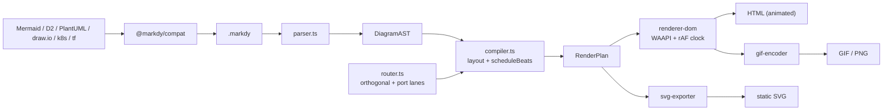
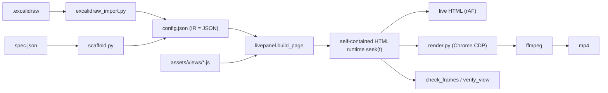
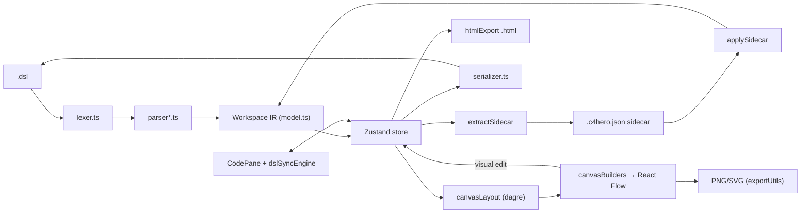
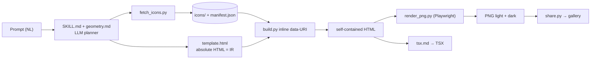

# Weekly scan — diagram tooling (2026-11-18)

> Cửa sổ quét: pushed/created 2026-11-11 → 2026-11-18. Nguồn: GitHub search theo topic (`diagram-as-code`, `dsl`, `svg-animation`, `graph-visualization`, `layout-algorithm`) và keyword (`diagram`, `layout-engine`, `mermaid`), created trong 30 ngày gần nhất. Mỗi repo đều được shallow-clone và đọc trực tiếp source. GitHub API cho repo/release ngoài scope bị chặn, nên số contributor tính bằng `git shortlog` và bước 3 (scan release của mermaid/d2/elkjs…) **không chạy được** tuần này.

## Executive summary
- **Animation-as-storyboard là trend của tuần.** `markdy-com` (beat + WAAPI, playhead `currentTime` deterministic) và `live-panel-skill` (`seek(t)` thuần, Chrome CDP → ffmpeg) đều chọn mô hình "animation = pure function of time". Đây là hướng đáng cân nhắc cho timeline IR và target WebP/video của kymo. Lưu ý: SVG export của markdy là **tĩnh**, nên SVG self-contained có animation vẫn là điểm khác biệt của kymo.
- **Text↔visual round-trip:** `c4hero` dùng sidecar `.c4hero.json` (layout gắn theo view identity, không bao giờ xoá entry chỉ vì "vắng mặt") cùng `DslSyncEngine` có ownership/anti-clobber. Đây là mẫu tham khảo trực tiếp cho editor.kymo.studio. Điểm yếu: re-serialize toàn bộ nên mất comment.
- **Agent skill đang là kênh phân phối thắng thế.** `stack-diagram` đạt 2.6k★ trong ~2 tuần dù không có DSL hay layout engine (LLM tự tính toạ độ). Bài học thuộc về phân phối và icon pipeline (vendor-namespace, `manifest.json` để ghi credit), không phải kỹ thuật layout.

## Table of contents
- [Shortlist (9 repo)](#shortlist-9-repo)
- [1. HoangYell/markdy-com](#1-hoangyellmarkdy-com--markdyscript) — **study deeper**
- [2. ythx-101/live-panel-skill](#2-ythx-101live-panel-skill--animated-architecture-panel) — **study deeper**
- [3. c4hero/c4hero](#3-c4heroc4hero--structurizr-dsl-visual-editor) — **study deeper**
- [4. caru-ini/stack-diagram](#4-caru-inistack-diagram--agent-skill-vẽ-architecture-với-logo-chính-hãng) — glance only

## Shortlist (9 repo)
| Repo | ★ | Hoạt động 7 ngày | Lý do chọn / loại |
|---|---|---|---|
| HoangYell/markdy-com | 106 | 9 commit, v1.5.8 | DSL animated architecture; 17 layout mode; transpiler Mermaid/D2/PlantUML → deep-dive |
| ythx-101/live-panel-skill | 864 | 1 commit | JSON/Excalidraw → animated panel, deterministic `seek(t)` → deep-dive |
| c4hero/c4hero | 62 | 3 commit | Structurizr DSL ↔ canvas round-trip → deep-dive |
| caru-ini/stack-diagram | 2588 | 3 commit, v0.6.0 | Agent skill vẽ architecture với icon chính hãng → deep-dive |
| hikerpig/pintora | 1283 | 4 commit | Text-to-diagrams đa loại, chạy trong browser và node. Đã trưởng thành, tuần này không có thay đổi kiến trúc → để tuần sau |
| ChanMeng666/archlang | 83 | 278 commit | "Floor plans as code": adjacent DSL. Repo ~190k LOC và commit dồn dập; cần đánh giá riêng |
| iiwish/kgdiff | 62 | 50 commit | Semantic + visual diff cho knowledge graph (RDF/OBO); ý tưởng diagram diff |
| Goblinmine/homelab-diagram | 1363 | 2 commit | YAML → SVG/PNG network diagram (Python, ~1k LOC); nhỏ, glance |
| bassnova42/arch-diagram-skill | 137 | 0 commit | Repo/article → arch diagram skill; ~700 LOC, không hoạt động trong tuần |

Loại khỏi danh sách: `andy-frost-2006/microsoft-visio-desktop` và hai repo LanFlow (`doris-arzuaga/…`, `SANJAY-102/…`) có dấu hiệu repo "setup/download" spam; graph-viz chung (networkx, G6, pygraphistry) vì không phải diagram-as-code; `hypit-ai/hypit` vì không liên quan.

---

## 1. HoangYell/markdy-com — MarkdyScript

### §1 — Quick context
- **Pitch:** DSL kiến trúc có khái niệm `beat` (storyboard) — diagram là *kịch bản animation* từng bước, không chỉ là ảnh tĩnh có hiệu ứng.
- **Stack:** TypeScript monorepo (pnpm, tsup, vitest); `@markdy/core` zero-dep; render bằng DOM + Web Animations API (WAAPI); export SVG tĩnh / PNG / GIF89a.
- **Health:** 106★, v1.5.8 (2026-11-14), 9 commit trong 7 ngày; thực chất 1 tác giả (+ commit "Yell Agent"); CI matrix Node 18/20/22; ~88 test core.
- **Distribution:** npm (`@markdy/core`, `@markdy/cli`, `@markdy/mcp-server`), VS Code/Open VSX extension, web playground.

### §2 — Architecture deep-dive

**A. Component inventory**
- `Parser` (`packages/core/src/parser.ts`, 1347 LOC) — indentation-aware, regex statement matching → `DiagramAST`.
- `AST/RenderPlan types` (`packages/core/src/ast.ts`) — `DiagramAST` (meta/styles/nodes/edges/groups/patterns/beats/diagnostics) và `RenderPlan`.
- `Compiler` (`packages/core/src/compiler.ts`, 2371 LOC) — `compilePlan()`: sizing, rank, ~17 layout mode (`layoutRanked/Tree/Swimlane/Gantt/Venn/Radar/...`), `scheduleBeats()`.
- `Router` (`packages/core/src/router.ts`) — orthogonal Manhattan router, `allocatePortLanes()`, obstacle avoidance, rounded corners.
- `Vocabulary/Registry` (`packages/core/src/system-vocabulary.ts`, `registry.ts`) — node kind → role → màu/icon; danh sách cue/operator.
- `DOM renderer` (`packages/renderer-dom/src/diagram.ts`, `nodes.ts`, `edges.ts`) — dựng DOM + SVG overlay, WAAPI keyframes.
- `Exporters` (`packages/renderer-dom/src/export/{svg,png,gif}-exporter.ts`, `gif-encoder.ts`).
- `Compat transpilers` (`packages/compat/src/{mermaid,infra}/*`) — Mermaid, D2, PlantUML, draw.io, docker-compose, k8s, Terraform → MarkdyScript.
- `CLI` (`packages/cli/src/index.ts`), `LSP` (`packages/markdy-language-server`), `MCP server` (`packages/mcp-server`).

**B. Happy path**
1. User chạy `npx @markdy/cli render system.markdy --out d.svg`.
2. `parse()` strip comment `//`, match từng block theo `TOP_LEVEL_KEYWORDS_RE`, gom body thụt lề của `beat/group/pattern` → `DiagramAST`.
3. `compilePlan(ast, theme)` → `computeAdaptiveDimensions` (snap lưới 16px), `layoutNodes` chọn mode, route edge, `scheduleBeats` → `RenderPlan` có `TimedCue[]`.
4. `.svg` → `renderPureVectorSvg(plan)` (tĩnh); `.html` → `createDiagram()` phát WAAPI.
5. Ghi file.

**C. Data model / IR** — plain TS interfaces, 2 tầng rõ ràng: `DiagramAST` (declarative) → `RenderPlan` (positioned nodes, routed edges, group boundaries, timed cues, beat ranges). Đây đúng là "lower IR": renderer chỉ playback, không tính layout. Compiler tạo object mới (không mutate AST theo thiết kế, dù không freeze).

**D. Input language** — line/indent-based, regex; không có EBNF (spec ở `docs/SYNTAX.md` + `AGENT.md` cho LLM). Cú pháp đáng chú ý: flow chain `A -> B "label" -> C`, response `<-`, async `~>`, `&` để chạy cue song song, `stagger=60ms`, `frame … zoom=1.12` (camera). Error: `ParseError` có line/column; `syntax-diagnostics.ts` (1114 LOC) + "indent recovery" tự sửa body mất thụt lề trong MDX; `ai-healing.ts` sinh prompt sửa lỗi cho LLM.

**E. Layout** — tự viết, không ELK/dagre. `assignRanks` = longest-path qua Kahn topo-sort, phá cycle bằng cách lấy node chưa xử lý theo declaration order; ordering = group cluster → **barycenter** theo parent → declaration order, rồi 4 sweep **adjacent-swap** giảm crossing. Edge: orthogonal + port lanes (chia đều cạnh khi nhiều edge vào một side) + self-loop riêng. Nhiều layout "template" (quadrant, pyramid, venn, radar) là đặt chỗ cố định, không phải graph layout.

**F. Rendering** — 2 backend thực: DOM/WAAPI (animated) và pure-vector SVG (không có `<animate>`/`@keyframes` → **SVG xuất ra là tĩnh**). Animation: mọi WAAPI animation *luôn paused*, một vòng `requestAnimationFrame` gán `anim.currentTime = sceneMs` → deterministic, scrub được; dùng `fill:"forwards"` + pre-set inline style để né lỗi cascade của `fill:"both"` (`docs/ARCHITECTURE.md`). GIF tự encode.

**G. Extensibility** — không plugin system; thêm node kind/cue/operator bằng sửa 3–4 registry (quy trình ghi trong ARCHITECTURE.md). Theme qua `themes.ts` + `theme-generator.ts`.

**H. DX** — CLI đầy đủ (`lint/fmt/render/diff/import/verify/drift/c4`), LSP, VS Code live preview, playground có timeline scrub, share-link nén vào URL hash (`url-codec.ts`), MCP server + agent skills.

### §3 — Architecture diagram

### §4 — Verdict
- **Học cho kymo:** (1) tách `RenderPlan` có `TimedCue[]` — kymo có thể compile animation thành timeline IR riêng thay vì rải CSS trong `to_svg.py`; (2) cú pháp `beat` + `&` + `stagger` + `frame zoom` là thiết kế storyboard gọn, đáng so với cơ chế animate hiện tại của kymo; (3) `allocatePortLanes` ≈ fan-in staggering của `alignment.py` — so sánh để tham khảo spacing/padding; (4) chuỗi transpiler D2/PlantUML/Mermaid → DSL.
- **Red flags:** monolith `compiler.ts` 2.4k LOC; layout chỉ heuristic (không full Sugiyama); README nặng marketing; transpiler ~200 LOC mỗi format, regex-based → độ phủ thấp; SVG export mất animation.
- **Open questions:** WAAPI cue có map được sang SMIL/CSS cho SVG standalone không?
- **Verdict: study deeper** (đối thủ trực tiếp về "animated diagram-as-code").

---

## 2. ythx-101/live-panel-skill — animated architecture panel

### §1 — Quick context
- **Pitch:** Từ một JSON config (hoặc file `.excalidraw`) dựng sơ đồ kiến trúc trông như đang chạy: layout đứng yên, chỉ system state chuyển động. Xuất ra mp4 hoặc HTML.
- **Stack:** Python 3.8+ (chỉ stdlib), headless Chrome qua DevTools pipe, ffmpeg. Runtime viết bằng vanilla JS (`assets/template.html`, `assets/views/*.js`).
- **Health:** 864★. Thực tế khoảng 3 người đóng góp: ythx-101, ABCLDZ và bot Cursor. Chưa có tag/release, không có `.github/` nên không có CI. Có unittest (`tests/test_offline.py`, `tests/test_cycle_replay.py`). Commit cuối ngày 2026-11-12.
- **Distribution:** `git clone`, hoặc copy vào `~/.claude/skills/`. Repo không có `package.json`/`pyproject.toml`.

### §2 — Architecture deep-dive
**A. Component inventory**
- `Page builder + CDP driver` (`scripts/livepanel.py`): `build_page` nhúng config, views và fonts vào template; class `Chrome` gửi lệnh CDP qua pipe fd 3/4.
- `Frame renderer` (`scripts/render.py`): vòng lặp `seek(i/fps)` → screenshot → pipe vào ffmpeg libx264.
- `Runtime` (`assets/template.html`): machines, builders, `window.seek`, `__check`, `LP.registerView`.
- `Views` (`assets/views/{ring,funnel,loop,excalidraw,sketchboard}.js`): plugin tự layout bên trong một rect được giao.
- `Excalidraw importer` (`scripts/excalidraw_import.py`): chuyển `.excalidraw` thành config.
- `Scaffolder` (`scripts/scaffold.py`): spec ngắn → auto layout theo hàng → config đầy đủ.
- `QA` (`scripts/check_frames.py`, `verify_view.py`): kiểm tra overflow, overlap, contrast, edge xuyên box, flicker, và chạy replay để so khớp.

**B. Happy path**
1. Viết `config.json` bằng tay, hoặc sinh ra bằng `scaffold.py` / `excalidraw_import.py`.
2. `build_page` thay các placeholder `<!--LIVE_CONFIG-->`, `<!--LIVE_VIEWS-->`, `<!--LIVE_FONTS-->` (font được subset bằng fontTools nếu có) và cho ra một HTML self-contained.
3. Chrome mở trang với `?manual` rồi chờ `window.__ready`.
4. Mỗi frame: gọi `seek(t)`, chụp `Page.captureScreenshot`, đẩy vào stdin của ffmpeg (kèm một track AAC câm).
5. Tuỳ chọn: chạy `check_frames.py --repeat` để chứng minh output deterministic.

**C. Data model / IR.** Không có IR trung gian, runtime đọc thẳng JSON (`references/config-schema.md`):
- `elements` là danh sách vẽ theo z-order.
- `machines` (`counter`, `cycle`, `gauge`, `lane`, `triggers`) là các *pure function of t*.
- State thay đổi nằm trong biến `V`, style được chọn qua `when/then` (`template.html` L162–373).

Phần "lowering" duy nhất là Excalidraw→config và spec→config, cả hai làm bằng Python.

**D. Input language.** Không có DSL. JSON schema chỉ được mô tả bằng văn xuôi, không có grammar hình thức. Template dùng `{var}` (`fill`, L72). Lỗi được gom trong lúc chạy qua `fail()` → `window.__error`, rồi Python in ra; không có vị trí line/col.

**E. Layout.** Mặc định là toạ độ pixel tuyệt đối do người viết đặt; README thừa nhận "a config is authored for one canvas". Có auto layout nhưng chỉ cục bộ:
- `scaffold.py` xếp node theo hàng, có wrap text.
- `loop.js` bẻ edge hình chữ Z để đi qua khe giữa các group (L503).
- Excalidraw importer giữ nguyên binding, re-anchor arrow vào cạnh node và chọn vị trí label bằng hàm điểm theo khoảng trống quanh obstacle (L195–230).

Crossing minimization: không xác định.

**F. Rendering.** Một backend DOM (div tuyệt đối + SVG polyline), xuất ra mp4 qua frame capture hoặc HTML live chạy bằng `requestAnimationFrame`. Kỹ thuật cốt lõi là cấm CSS animation và cấm `Math.random`: mọi trạng thái đều suy ra từ `seek(t)`, phần ngẫu nhiên dùng integer hash có seed (L54). Ngay cả rough.js cũng bị ép dùng PRNG có seed (`views/excalidraw.js` L1–10).

**G. Extensibility.** `LP.registerView(kind,{build,seek,events?,check?})`, mỗi view là một file JS được inline tự động; contract nằm ở `references/views.md`. Theme preset cho phép override từng màu.

**H. DX.** Tooling thiết kế cho agent: `SKILL.md` yêu cầu "draft on disk by fifth tool call" và cấm agent tự nhẩm toạ độ pixel. Verifier render đủ 3 preset × 2 theme. Không có watch mode.

### §3 — Architecture diagram

### §4 — Verdict
- **Học cho kymo:**
  1. Animation là *pure function of t*: dùng seed cho mọi phần ngẫu nhiên và có `seek(t)` để capture từng frame deterministic. Mô hình này hợp với target WebP của kymo, và test được bằng cách replay rồi so khớp.
  2. `references/motion-grammar.md` (ba nhịp nhanh/vừa/chậm, "motion = system state") có thể dùng làm vocabulary cho animation của kymo.
  3. Cách import Excalidraw: map `startBinding/endBinding` → `{from,to,side,off}`, chọn màu theo palette gần nhất, BFS trên các arrow để ra thứ tự step, chấm điểm vị trí label. Sát với hướng importer của kymo.
  4. QA trên DOM: phát hiện overlap và edge xuyên box.
- **Red flags:** toạ độ tuyệt đối, không có grammar, không CI, bus factor ≈ 1, phụ thuộc Chrome + ffmpeg.
- **Open question:** chưa thấy view nào có crossing minimization.
- **Verdict: study deeper** (riêng phần animation determinism và Excalidraw import).

---

## 3. c4hero/c4hero — Structurizr DSL visual editor

### §1 — Quick context
- **Pitch:** Canvas kéo-thả cho C4, lưu ra `.dsl` Structurizr thuần trên máy, layout để riêng trong sidecar. Khác Structurizr Lite ở chỗ không cần server và chỉnh được trực tiếp trên canvas.
- **Stack:** React 19, TS strict, Vite, Zustand + immer, `@xyflow/react`, `@dagrejs/dagre`, CodeMirror 6.
- **Health:** 62★. 2 người đóng góp (35 + 2 commit) cùng dependabot; tag `v0.7.0`. CI khá dày: lint, typecheck, coverage, conformance với Structurizr CLI, Playwright e2e, gitleaks; khoảng 2.950 test case `it(`.
- **Distribution:** static web app / PWA (app.c4hero.com); package để `private: true`.

### §2 — Architecture deep-dive
**A. Component inventory**
- `Lexer` (`src/lib/dsl/lexer.ts`): token kèm line/col, có token `COMMENT`.
- `Parser` (`src/lib/dsl/parser.ts` + `parser-model/views/styles/relationship/deployment.ts`): token → `Workspace`.
- `Serializer` (`src/lib/dsl/serializer.ts`, 1805 LOC): `Workspace` → DSL đã chuẩn hoá.
- `Domain model` (`src/types/model.ts`).
- `Store` (`src/store/workspace.ts` + `slices/`): Zustand + immer, undo bằng snapshot.
- `Sidecar` (`src/lib/sidecar.ts`, `layoutIdentity.ts`): lưu layout, status, lineStyle.
- `DslSyncEngine` (`src/components/code-pane/dslSyncEngine.ts`): đồng bộ hai chiều text ↔ store.
- `canvasLayout` (`src/lib/canvasLayout.ts`): bọc dagre.
- `canvasBuilders` + `handleSlots` (`src/components/canvas/`): biến view thành node/edge của React Flow.
- `includeWriteback` (`src/lib/includeWriteback.ts`): ghi ngược thay đổi vào các fragment được `!include`.
- `Exporters` (`exportUtils.ts`, `htmlExport.ts`) và `Importers` (`src/lib/import/`, hỗ trợ C4-PlantUML và Mermaid C4).

**B. Happy path**
1. Mở `.dsl` cùng sidecar (`fileIO.ts` / `folderIO.ts`).
2. `parseWorkspaceDocument` gọi `parseDSL`, sau đó `applySidecar`.
3. Nếu DSL không khai báo view, `auto-views.ts` sinh view mặc định.
4. `canvasBuilders` dựng React Flow; `applyAutoLayout` đặt vị trí cho các node chưa có toạ độ.
5. Sửa trên canvas sẽ cập nhật store qua immer. Khi save, `serializeDSL` ghi ra `.dsl` và `extractSidecar` ghi ra `.json`.

**C. Data model / IR.** Chỉ có một `Workspace` gồm model và views; mỗi view là một projection gồm danh sách element id cộng layout của từng node. IR là mutable, sửa qua immer draft. Không có tầng IR thấp hơn: AST chính là model.

**D. Input language.** Parser recursive descent viết tay theo kiểu class (`peekType()`/`advance()`), không có EBNF.
- Lỗi có dạng `{message,line,column}`. Parse lenient, nhưng `replaceWorkspaceFromDSL` từ chối text còn lỗi, và chặn trường hợp text làm rỗng một model đang có nội dung (`lifecycle-slice.ts:207+`).
- **Comment và formatting không được giữ lại.** Parser bỏ qua token `COMMENT`, còn serializer sinh lại toàn bộ text. Người dùng được cảnh báo phần mất mát qua `serializationLoss.ts`.
- Correctness được kiểm bằng Structurizr CLI thật làm oracle (`structurizr-conformance.test.ts`), cộng fuzzing (`src/lib/dsl/fuzz/`).

**E. Layout.** dagre compound graph (`ranksep:300`, `nodesep:250`), group được dùng làm cluster.
- Node đã khoá hoặc ghim thì giữ nguyên vị trí. Layout mới được "stitch" vào toạ độ đã lưu bằng offset trung bình (`canvasLayout.ts:402-609`).
- Sidecar khớp layout theo **view identity** (type + scope + tập `elementIds`) và không xoá entry khi view tạm vắng mặt (`docs/layout-persistence.md`).
- Edge gắn vào 7 slot neo trên mỗi cạnh node (`handleSlots.ts`). Crossing minimization chỉ có phần dagre tự làm.

**F. Rendering.** React Flow trên DOM. PNG/SVG xuất qua `html-to-image`; HTML self-contained có SVG inline. Animation: không xác định. Backend không pluggable.

**G. Extensibility.** Có theme, Tag Manager, importers, và AI qua `AiProvider`/`EditActions`. Không có plugin system.

**H. DX.** Code pane CodeMirror sync hai chiều (debounce 500/200 ms), có quy tắc ownership để hai phía không ghi đè nhau. Ngoài ra có command palette, autosave, và `useDiskWatch.ts` để reload khi file trên đĩa thay đổi.

### §3 — Architecture diagram

### §4 — Verdict
- **Học cho kymo (editor.kymo.studio):**
  1. Lưu layout trong sidecar có identity, khớp hai chiều và không bao giờ xoá entry chỉ vì "vắng mặt".
  2. Sync engine tách khỏi UI, có ownership, không áp text lỗi, và chặn việc làm rỗng model.
  3. Dùng parser chính chủ làm oracle kèm fuzzing, cùng tinh thần với conformance suite Python↔JS của kymo.
  4. Báo rõ mất mát khi serialize, theo kiểu `serializationLoss`.
- **Red flags:** mỗi lần save đều mất comment và formatting (regenerate, không phải CST/lossless); bus factor 1; không có animation.
- **Open question:** có kế hoạch chuyển sang lossless CST không?
- **Verdict: study deeper** (sidecar + sync engine).

---

## 4. caru-ini/stack-diagram — Agent Skill vẽ architecture với logo chính hãng

### §1 — Quick context
- **Pitch:** Không có DSL hay layout engine. LLM *chính là* layout engine: tự đặt toạ độ tuyệt đối vào một template HTML, script chỉ inline logo chính hãng rồi chụp ra PNG.
- **Stack:** Python ≥3.9 (chỉ stdlib), Playwright/Chromium, template HTML/CSS. Gallery `site/` dùng TanStack Start + Cloudflare Workers + Neon/Drizzle.
- **Health:** 2588★ sau khoảng 2 tuần (tạo ngày 2026-11-01). 5 contributor, nhưng 30/34 commit là của owner. Tag v0.1.0 → v0.6.0 (2026-11-13). CI chỉ áp dụng cho `site/` và việc zip release; bản thân các script của skill không có test.
- **Distribution:** cài bằng `npx skills add caru-ini/stack-diagram`, hoặc tải zip từ GitHub Releases.

### §2 — Architecture deep-dive
**A. Component inventory**
- `Orchestrator` (`skills/stack-diagram/SKILL.md`): workflow 7 bước viết bằng ngôn ngữ tự nhiên, kèm các vendor rule.
- `Icon fetcher` (`scripts/fetch_icons.py`): tìm logo, tải về và ghi `manifest.json`.
- `Geometry spec` (`references/geometry.md`): quy định toạ độ, khoảng cách và cách neo edge để LLM tự tính.
- `Template` (`assets/template.html`): markup mẫu, đồng thời là hệ CSS token.
- `Builder` (`scripts/build.py`): thay các token `%%ICON_x%%` bằng base64 data URI.
- `Rasterizer` (`scripts/render_png.py`): headless Chromium chụp PNG cả light lẫn dark.
- `TSX guide` (`references/tsx.md`) và `share.py`: đăng diagram lên gallery, có SHA-256 proof-of-work.

**B. Happy path**
1. LLM rút nodes, groups và edges từ câu mô tả của user.
2. Chạy `fetch_icons.py <dir> spec…` để có `icons/` và `manifest.json`.
3. LLM tính toạ độ theo `geometry.md` rồi sửa thẳng vào `template.html`.
4. `build.py` inline asset; nếu còn token chưa resolve thì báo lỗi.
5. `render_png.py` xuất PNG. LLM tự xem ảnh theo checklist và sửa lại cho đến khi không còn lỗi.
6. Giao HTML, PNG hoặc TSX.

**C. Data model / IR:** không có IR. Source of truth là file HTML gồm các `div` `position:absolute` cộng một SVG overlay, và LLM mutate trực tiếp file này. Không có bước lowering.

**D. Input language:** đầu vào là ngôn ngữ tự nhiên, không có parser hay grammar. Chỉ có cú pháp icon spec (`name`, `name:slug`, `name=URL`, `name:aws/…`), được parse bằng regex trong `sources()`. Lỗi được báo ở `build.py` ("unresolved tokens") và `fetch_icons.py` (in `FAIL` kèm danh sách tên hợp lệ).

**E. Layout:** manual, do LLM tính:
- Node box 132×100; hai node cách nhau ≥140px, mỗi hàng cách nhau 140px; group padding là centerX±90.
- Edge routing là orthogonal "viết tay": elbow chạy trong corridor trống.
- Không dùng ELK hay dagre. Không có crossing minimization; doc còn nói rõ edge cắt nhau "is normal".
- Label chống đè bằng halo `paint-order: stroke`.

**F. Rendering:** chỉ render qua browser (HTML/CSS). PNG là screenshot từ Playwright; TSX do LLM tự chuyển đổi. Dark mode qua `data-theme`, marker dùng `context-stroke`. Không có animation và không có cơ chế backend pluggable.

**G. Extensibility (icons):** thứ tự fallback là svgl (khớp title chính xác) → devicon → gilbarbara/logos.
- Các namespace `aws/`, `gcp/`, `azure/`, `k8s/` chỉ lấy từ package chính thức của vendor, **không** fallback sang bản bên thứ ba.
- `lucide/` dùng cho các khái niệm trừu tượng.
- Heuristic `white_fill()` đặt logo trắng lên tile tối; quy tắc chung là không bao giờ đổi màu logo.

**H. DX:** cơ chế QA chính là vòng "render → tự nhìn ảnh → sửa". Không có watch mode hay LSP. Cần network và Chromium.

### §3 — Architecture diagram

### §4 — Verdict
- **Học cho kymo:**
  - Resolver icon có thứ tự fallback rõ ràng. Namespace vendor-official không fallback, và `manifest.json` ghi `source` để tự sinh credit; cả ba ý đều áp dụng được cho root `icons/` của kymo.
  - Cặp logo `lt`/`dk` cùng heuristic `white_fill` cho theme tối.
  - Đóng gói thành Agent Skill (`SKILL.md` + zip release) để agent gọi `kymo` là kênh phân phối rất rẻ; con số 2.5k★ trong 2 tuần cho thấy độ hiệu quả.
- **Red flags:** toạ độ do LLM tính nên không tái lập được (non-deterministic); không có test; phụ thuộc CDN lúc build; tính pháp lý khi phân phối logo vendor chưa rõ.
- **Open question:** còn giữ được chất lượng khi diagram vượt ~15 node không? (không xác định)
- **Verdict: glance only.** Đáng xem phần icon pipeline và cách đóng gói skill; tín hiệu đáng chú ý là kymo có thể thay "LLM tự đặt toạ độ" bằng một layout engine thật.
