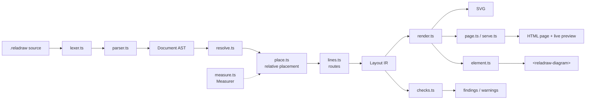
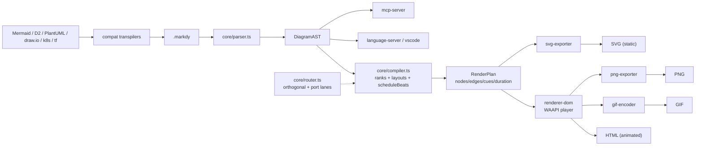
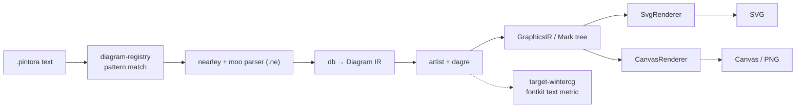

# Weekly scan — diagram tooling · 2026-11-19

> Cửa sổ quét: `pushed:>2026-11-12`. Nguồn: GitHub topic search (`diagram-as-code`, `dsl`, `svg-animation`, `graph-visualization`, `layout-algorithm`) + keyword search (`diagram created:>2026-10-20 stars:>100`). Topic search đã ra ≥4 ứng viên phù hợp nên không chạy bước 3 (quét release ecosystem). Mọi nhận định bên dưới dựa trên code đọc từ shallow clone (depth 50) ngày 2026-11-19; số stars lấy từ kết quả search. GitHub REST API (contributors/releases) bị chặn ngoài scope của session, nên cột "contributors" là số author khác nhau trong 50 commit gần nhất.

## Executive summary

- **reladraw** (1.2k★, v0.32.0 ra ngày 2026-11-18) là repo đáng chú ý nhất tuần này với kymo. Đây là DSL **relative placement, không auto-layout, không né vật cản**: mỗi trục của mỗi box do đúng một statement quyết định, và lỗi hiển thị (đè chữ, line cắt box) được báo thành *finding* chứ engine không tự sửa. Đây là đúng triết lý "renderer dumb" của kymo, nhưng reladraw đẩy nó xa hơn: có grammar dùng chung cho highlighter, cơ chế `blame` lỗi theo dòng, và lint đo trên geometry.
- **markdy-com** (107★, v1.5.8 ra ngày 2026-11-14) là đối thủ trực tiếp gần nhất của kymo: *animated architecture diagram as code*. Animation được kể theo kiểu storyboard qua `beat` (show / frame / glow, `&` để chạy song song) và chạy bằng Web Animations API trong DOM. Tuy vậy **SVG export là tĩnh**, nên kymo vẫn giữ lợi thế "animated SVG tự chứa". Repo còn có 7 transpiler (Mermaid, D2, PlantUML, draw.io, k8s, compose, terraform) nên đáng benchmark.
- **pintora** (1.3k★) và **stack-diagram** (2.6k★) là tín hiệu phụ. Pintora vá liên tiếp 3 bug cùng một kiểu, *keyword của lexer rò vào identifier* (#460–#462), và đây là bài học trực tiếp cho parser line-based của kymo. Stack-diagram chứng minh một trend: dùng **LLM làm layout engine**, dựa vào một file `geometry.md` quy định luật toạ độ thay vì viết code layout.

## Table of contents

1. [reladraw/reladraw](#1-reladrawreladraw) — study deeper
2. [HoangYell/markdy-com](#2-hoangyellmarkdy-com) — study deeper
3. [hikerpig/pintora](#3-hikerpigpintora) — glance only
4. [caru-ini/stack-diagram](#4-caru-inistack-diagram) — glance only
5. [Đã loại](#đã-loại)

---

## 1. reladraw/reladraw

### §1 — Quick context

- **Pitch:** DSL nằm giữa Mermaid và draw.io. Người viết *nói vị trí tương đối* (`right of x (gap: 12) even with y`), còn engine chỉ tính toạ độ, không bao giờ tự di chuyển box.
- **Stack:** TypeScript, zero runtime deps; output SVG, HTML page (`--page`) và custom element `<reladraw-diagram>`.
- **Health:** 1201★, 1 author, release 0.32.0 ngày 2026-11-18 (37 commit trong 7 ngày). **Không có test và không có CI** trong repo.
- **Distribution:** npm `reladraw` (bin `reladraw`), có jsDelivr cho bản browser.

### §2 — Architecture deep-dive

**A. Component inventory**
- `Lexer` (`src/lexer.ts`): tách token theo từng dòng. Ngoặc `(` chỉ được tính là token ở đầu một từ, nhờ vậy `rgb(20,20,20)` không bị cắt. Token giữ offset `start/end` để formatter copy nguyên văn.
- `Parser` (`src/parser.ts`, 4k LOC): từ token sinh ra `Document` gồm các `Stmt` (định nghĩa trong `src/ast.ts`).
- `Resolver` (`src/resolve.ts`): biến AST thành `Layout` với `LayoutNode` và `LayoutEdge` (`src/model.ts`). Ở bước này resolve style, default và theme.
- `Placer` (`src/place.ts`): tính toạ độ của box và container.
- `Lines` (`src/lines.ts`): định tuyến edge (straight / square / curved, `via:`).
- `Checks` (`src/checks.ts`): sinh *findings* (`text-overlap`, `edge-node-overlap`, `crowded-edge-ends`…).
- `Renderer` (`src/render.ts`): chuyển `Layout` thành chuỗi SVG.
- `Measure` (`src/measure.ts`): interface `Measurer`. Trong Node mặc định giả định font monospace, trong browser thì đo bằng DOM.
- `Grammar` (`src/grammar.ts`): bộ scanner regex từng dòng dành cho highlighter, cố ý *không* phải parser thứ hai.
- `Format` (`src/format.ts`), `Serve` (`src/serve.ts`), `Page` (`src/page.ts`), `Element` (`src/element.ts`).

**B. Pipeline (happy path)**
1. User chạy `reladraw render a.reladraw -o a.svg` (`src/cli.ts`).
2. `draw()` (`src/index.ts`) gọi `parse(text)` để có `Document` AST.
3. `resolve(doc)` cho ra `Layout`. Trong bước này `place.ts` tính box theo từng trục, theo lazy dependency, và `lines.ts` tính route.
4. `render(layout)` trả về chuỗi SVG. Song song, `findings(layout, checks)` cho ra danh sách cảnh báo.
5. CLI ghi file SVG và in warning mỗi cái một dòng. Nếu có `SourceError`, `blame()` chạy lại để chỉ ra *dòng nào gây lỗi* trong một statement viết trên nhiều dòng.

**C. IR:** dùng TS interfaces thuần (`LayoutNode` có `parent/children/heading/joinWith`). Có hai tầng rõ ràng là `Document` (AST) và `Layout` (geometry đã giải). Comment ghi chú rằng `body` được "resolved once… so the resolver… and the renderer… cannot disagree", tức là coi Layout là single source of truth cho cả render lẫn checks.

**D. Input language:** parser viết tay, line-oriented; một statement có thể nối sang các dòng thụt lề. Chuỗi `"""` nhiều dòng được xử lý bằng cách bắt `OpenString` rồi thử ghép thêm dòng tiếp. **Không có EBNF**; `SYNTAX.md` (1983 dòng) là spec bằng văn xuôi. Comment trong code nhắc tới `design.org` nhưng file này không có trong repo. Lỗi là `SourceError` có line, kèm "near match" khi người viết gõ sai.

**E. Layout:** *không có auto layout*. `place.ts` mô tả: "Nothing here is solved and nothing is pushed… each axis of each box comes from exactly one statement". Mỗi giá trị được tính on-demand rồi memo lại; nếu gặp chu trình thì báo lỗi kèm các placement tạo ra chu trình đó. Toạ độ tính theo từng frame (container). Edge routing gồm straight (mặc định), `square` (orthogonal) và `curved` (cubic). Không né vật cản, không có crossing minimization; điểm duy nhất được chia sẻ là *side spreading* khi nhiều đầu edge cùng nằm trên một cạnh.

**F. Rendering:** chỉ có một backend SVG. `renderTagged` gắn thêm id để trang `serve` biết click vào box nào thì highlight statement tương ứng. Không có animation.

**G. Extensibility:** có themes (`src/themes.ts`), `style` có tên, `default edge …`, icon (`src/icons.ts`) và `badge:`. Không có plugin system.

**H. DX:** `check`, `format --check`, `serve` (live reload, click box sẽ highlight source; nút feed màu xanh lá, nút được feed màu đỏ), `install-skill` cho Claude/Codex, và `llms.txt`.

### §3 — Architecture diagram

### §4 — Verdict

- **Học cho kymo:** (1) Mô hình *findings đo trên geometry đã resolve* (overlap/overflow) có thể đặt thành một `kymo check` chạy sau `resolve_alignments()`, đúng hướng "renderer dumb". (2) Luật *mỗi trục chỉ do đúng một statement quyết định* kèm phát hiện chu trình là cách làm parent/child anchoring của kymo trở nên có thể giải thích được. (3) `blame()` re-run để chỉ ra đúng dòng lỗi. (4) Tách `grammar.ts` (regex highlighter) khỏi parser, dùng chung vocabulary.
- **Red flags:** không có test và CI dù code đã 28k LOC; chỉ một author và không nhận PR; syntax "changing frequently".
- **Open question:** monospace `Measurer` trong Node có làm SVG từ CLI lệch so với browser không?
- **Verdict:** **study deeper**.

---

## 2. HoangYell/markdy-com

### §1 — Quick context

- **Pitch:** DSL kể chuyện kiến trúc theo *beat* (storyboard). Sơ đồ có camera `frame`/zoom, chạy ở 60fps bằng Web Animations API, và có MCP server cho agent.
- **Stack:** TypeScript monorepo (pnpm). `@markdy/core` không có dependency; `renderer-dom` dùng `html2canvas`. Output gồm HTML tương tác, SVG tĩnh, GIF và PNG.
- **Health:** 107★, 4 author gần đây, v1.5.8 ngày 2026-11-14. CI (`ci.yml`) chạy typecheck, lint, test, `gate` và `verify:examples`; `core/tests` có 15 spec.
- **Distribution:** npm `@markdy/*`, extension cho VS Code/Open VSX, plugin Astro/MDX, MCP server.

### §2 — Architecture deep-dive

**A. Component inventory**
- `Parser` (`packages/core/src/parser.ts`): biến source thành `DiagramAST`; xử lý block indent, `var`/`$var`, `pattern` macro.
- `Compiler` (`packages/core/src/compiler.ts`, 2.4k LOC): biến AST thành `RenderPlan` (toạ độ cùng `TimedCue[]`).
- `Router` (`packages/core/src/router.ts`): "Collision-aware Orthogonal Manhattan Router with Dynamic Port Multiplexing" (`allocatePortLanes`, `routeAroundObstacles`).
- `Registry` (`core/src/registry.ts`): khai báo node kind (`gateway`, `cache`, `database`…) và alias.
- `Lint/verify` (`core/src/arch-lint.ts`, `verifier.ts`, `drift.ts`, `c4.ts`).
- `DOM renderer` (`packages/renderer-dom/src/diagram.ts`, `edges.ts`, `nodes.ts`): animation bằng `element.animate(...)`.
- `Exporters` (`renderer-dom/src/export/svg-exporter.ts`, `gif-encoder.ts`, `png-exporter.ts`).
- `Compat` (`packages/compat/src/{mermaid,infra}/*-transpiler.ts`): Mermaid, D2, PlantUML, draw.io, k8s, docker-compose, terraform → MarkdyScript.
- `CLI`, `language-server`, `vscode`, `mcp-server`, `astro`, `mdx`.

**B. Pipeline (happy path)**
1. User chạy `npx @markdy/cli render system.markdy --out x.html`.
2. `parse()` tách dòng thành `Block` (theo indent), mở rộng `var`/`pattern`, rồi validate reference và cycle.
3. `compilePlan(ast, theme)` chọn layout theo `diagramType`, tính `computeGroupBoundaries`, route edge, rồi chạy `scheduleBeats` để có `cues` và `duration`.
4. Nếu đuôi là `.svg`, gọi `renderPureVectorSvg(plan)`. Ngược lại, `buildStandaloneHtml` nhúng renderer-dom, và player phát cue bằng WAAPI.
5. Ghi file.

**C. IR:** có hai tầng type thuần là `DiagramAST` và `RenderPlan` (`core/src/ast.ts:384`). `RenderPlan` gom `nodes` đã có vị trí, `edges` đã route, `cues: TimedCue[]`, `beats`, `duration`. Đây là "lower IR" đúng nghĩa: timeline được tính sẵn ở compile time, renderer chỉ việc phát lại.

**D. Input language:** parser viết tay dựa trên regex (`FLOW_OP_RE = /(->|<-|~>|--|\.\.>|<->)/`, `TOP_LEVEL_KEYWORDS_RE`). Cấu trúc khối theo indent kiểu Python (`beat x "...":`). Không thấy file EBNF; `AGENT.md` (33 KB) là spec dành cho agent. Lỗi được báo qua `ParseError(line, column)` cùng `syntax-diagnostics.ts` (1.1k LOC) và `ai-healing.ts`.

**E. Layout:** auto. `assignRanks` là topological rank theo kiểu Kahn, phá cycle bằng cách chọn root kế tiếp, rồi snap vào grid 4px. Ngoài ra còn khoảng 15 layout chuyên biệt (`layoutSwimlane`, `layoutPyramid`, `layoutQuadrant`, `layoutVenn`, `layoutTimeline`, `layoutGantt`, `layoutRadar`…). Edge là orthogonal Manhattan, có port lane multiplexing và route vòng qua obstacle. **Không thấy crossing minimization** (không có barycentric hay median ordering trong `layoutRanked`).

**F. Rendering:** có hai backend. (1) DOM: SVG layer và HTML node, animation bằng `Element.animate()` (WAAPI). (2) `svg-exporter.ts`: SVG thuần, `grep '@keyframes|<animate'` trả về 0, tức là **export SVG không có animation**. Ngoài ra còn GIF encoder tự viết và PNG qua html2canvas.

**G. Extensibility:** theme tokens cùng `theme-generator.ts` (sinh theme từ brand color), `stdlib-systems` (vocabulary node), `pattern` macro có tham số, và transpiler trong `compat`.

**H. DX:** LSP và VS Code preview (`Cmd+K V`), playground có scrub timeline, MCP server, và `check` lint theo thư mục.

### §3 — Architecture diagram

### §4 — Verdict

- **Học cho kymo:** (1) Cú pháp `beat` + `show/frame/glow` + `&` song song + `stagger=60ms` là ngôn ngữ storyboard gọn, đáng tham khảo nếu kymo muốn có animation theo bước do người viết điều khiển. (2) Tách `TimedCue[]` thành một bước compile và đưa vào IR là kiến trúc đúng; kymo có thể làm tương tự rồi emit thành CSS/SMIL trong SVG, việc mà markdy *chưa* làm. (3) `allocatePortLanes` có thể đối chiếu với fan-in staggering của kymo. (4) Bộ transpiler draw.io/D2/PlantUML là benchmark tham khảo cho cross-format.
- **Red flags:** compiler 2.4k LOC và `diagram.ts` 3k LOC là dấu hiệu god-file; CHANGELOG 155 KB cho thấy lượng commit lớn kiểu AI-generated; các transpiler chỉ khoảng 100–260 LOC nên có thể chỉ hỗ trợ một subset nông.
- **Verdict:** **study deeper**, ưu tiên phần `scheduleBeats` và `router.ts`.

---

## 3. hikerpig/pintora

### §1 — Quick context

- **Pitch:** thư viện text-to-diagram kiểu Mermaid nhưng *modular*: mỗi diagram là một bộ ba parser/db/artist, có thể đăng ký thêm, và chạy được cả trên edge runtime (WinterCG).
- **Stack:** TypeScript; nearley + moo cho grammar, `@pintora/dagre`, `@antv/g-svg` / `g-canvas`. Output SVG, Canvas, PNG (CLI dùng jsdom + node-canvas).
- **Health:** 1283★, 3 author gần đây, CI `ci-check.yml`, có jest spec và snapshot trong từng diagram. Trong 7 ngày có 5 commit, đều là fix parser.
- **Distribution:** npm `@pintora/*` (cli 0.8.1, diagrams 0.8.2).

### §2 — Architecture deep-dive

**A. Component inventory**
- `Core` (`packages/pintora-core/src`): `diagram-registry.ts`, `config-engine.ts`, themes, và kiểu `Mark` (`types/graphics.ts`).
- `Diagrams` (`packages/pintora-diagrams/src/<type>/`): `parser/*.ne` (nearley), `db.ts` (IR builder), `artist.ts` (IR → Mark), `event-recognizer.ts`. Các grammar dùng chung nằm ở `shared-grammars/*.ne` (config, style, bind, comment).
- `Renderer` (`packages/pintora-renderer/src/renderers/{SvgRenderer,CanvasRenderer}.ts`).
- `Standalone` (aggregate các package trên), `CLI`, `target-wintercg` (`runtime/text-metric.ts` đo chữ bằng fontkit và font SourceCodePro nhúng sẵn).

**B. Pipeline:** (1) `pintora render -i x.pintora -o x.svg`; (2) registry dò `pattern` (ví dụ `/^\s*sequenceDiagram/`) để chọn diagram; (3) parser nearley gọi action để đổ dữ liệu vào `db`, sinh ra IR; (4) `artist` dùng dagre để layout rồi sinh cây `Mark` (Group/Rect/Path/Text…); (5) `SvgRenderer` hoặc `CanvasRenderer` vẽ ra output.

**C. IR:** có hai tầng. *Diagram IR* riêng cho từng loại (ví dụ `SequenceDiagramIR`) và *GraphicsIR* (`Figure { mark, width, height }`) là cây draw instruction trung lập với backend. `db` là **singleton mutable**, phải gọi `db.clear()` giữa các lần parse.

**D. Input language:** grammar formal dạng nearley (`.ne`, tức Earley) cùng moo lexer có state. Grammar *chính là* spec. Bug tuần này (#460–#462) đều cùng một dạng: rule lexer khớp keyword (`inherit`, `left of`, keyword của gantt) *ở bất kỳ đâu trong dòng*. Cách fix là thêm lookbehind/lookahead `(?<=^|[ \t])…(?=[ \t])`.

**E. Layout:** hierarchical qua fork `@pintora/dagre` (Sugiyama, có crossing minimization theo kiểu dagre). Sequence, gantt, mindmap thì layout bằng tay trong artist.

**F. Rendering:** pluggable theo renderer (SVG/Canvas) trên cùng Mark tree. Không có animation.

**G. Extensibility:** `pintora.registerDiagram(name, { parser, artist, configKey })`; theme qua `themeConfig`; có skill `.ai/skills/add-new-diagram`.

**H. DX:** CLI dùng yargs; có `pintora-harness` (Playwright) để so sánh visual; chưa thấy LSP.

### §3 — Architecture diagram

### §4 — Verdict

- **Học cho kymo:** (1) Kiểu bug "keyword rò vào identifier" là rủi ro trực tiếp cho regex line-based của `dsl.py`/`dsl.ts`; nên thêm case vào conformance corpus (`conformance/corpus/`) với id/label chứa từ khoá như `layout`, `region`, `via`. (2) Tầng `Mark` trung lập backend giống hướng kymo muốn có cho Figma/Excalidraw. (3) Đo chữ bằng fontkit với font nhúng là lời giải cho text metric không cần browser.
- **Red flag:** `db` singleton mutable, không an toàn khi render đồng thời.
- **Verdict:** **glance only**, vì không có ý tưởng mới tuần này.

---

## 4. caru-ini/stack-diagram

### §1 — Quick context

- **Pitch:** không phải DSL mà là *agent skill*. LLM tự đặt toạ độ theo luật trong `geometry.md` và viết thẳng HTML/SVG có logo chính hãng. Thực chất là "LLM làm layout engine".
- **Stack:** Python stdlib (`fetch_icons.py`, `build.py`, `share.py`), Playwright để render PNG; site gallery bằng TS (`site/`, có drizzle). Output HTML tự chứa, PNG (light + dark), TSX.
- **Health:** 2631★ (tạo 2026-11-01), 5 author gần đây; workflow `release.yml`, `site.yml`; không thấy test.
- **Distribution:** `npx skills add`, file zip trên Releases.

### §2 — Architecture deep-dive

**A. Component inventory**
- `SKILL.md` (`skills/stack-diagram/SKILL.md`): workflow 7 bước và luật vendor (AWS/GCP/Azure/k8s).
- `Geometry rules` (`references/geometry.md`): node 132×100, khoảng cách 140px giữa các tâm node, luật anchoring edge ("vertical edges: box bottom → tile top").
- `Icon fetcher` (`scripts/fetch_icons.py`, 589 LOC): thử lần lượt svgl, devicon, gilbarbara/logos; với AWS/GCP/Azure/k8s/CNCF thì lấy từ package chính thức; ghi `manifest.json` và cờ `white_fill`.
- `Inliner` (`scripts/build.py`): thay token `%%ICON_x%%`/`%%FONT_*%%` bằng data URI; fail nếu còn token chưa thay.
- `PNG renderer` (`scripts/render_png.py`): Playwright chụp cả hai theme.
- `Template` (`assets/template.html`).

**B. Pipeline:** (1) user mô tả stack bằng câu chữ; (2) agent chọn node/group/edge; (3) chạy `fetch_icons.py`; (4) agent tự tính toạ độ theo `geometry.md` rồi viết HTML từ template; (5) `build.py` inline asset; (6) `render_png.py` sinh PNG, agent *xem lại ảnh* trước khi giao.

**C–E.** IR: **không xác định**, vì không có model; HTML chính là source of truth. Không có parser. Layout do LLM đặt tay theo luật; edge orthogonal được viết thẳng thành path `M…H…V`.

**F.** HTML/CSS cùng một SVG overlay cho edge; marker dùng `context-stroke` để arrowhead ăn theo màu line. Không có animation.

**G.** Thêm vendor bằng cách thêm nguồn icon trong `fetch_icons.py` và luật mới trong `SKILL.md`.

**H.** Không có CLI chung; vòng feedback là PNG cho agent tự nhìn lại.

### §3 — Architecture diagram

Insufficient evidence: không có parser và không có IR. Pipeline chỉ gồm agent, `fetch_icons.py`, template HTML, `build.py` và `render_png.py`, không đủ cho sơ đồ input → parser → IR → renderer.

### §4 — Verdict

- **Học cho kymo:** (1) `geometry.md` là một bộ hằng số spacing và luật anchoring rất cụ thể ("node = tile + text bên dưới, edge dọc nối từ đáy box") và có thể dùng để kiểm tra default spacing của kymo. (2) Chuỗi fallback icon chính hãng theo vendor và luật "never recolor a logo" liên quan tới `icons/` và `website-icons`. (3) Trend agent tự render PNG rồi tự nhìn lại: kymo MCP nên trả kèm PNG để agent tự kiểm.
- **Red flag:** layout không deterministic và không diff được; luật vendor dài, dễ drift.
- **Verdict:** **glance only**, đây là tín hiệu thị trường, không phải tham khảo kiến trúc.

---

## Đã loại

| Repo | Lý do |
|---|---|
| `Goblinmine/homelab-diagram` (1.4k★) | README tự nhận "not a general tool": toạ độ hand-placed trong `build.py`, chỉ cho một homelab cụ thể |
| `Qiuner/birdview`, `bassnova42/arch-diagram-skill` | Agent skill sinh diagram từ code; không có engine riêng |
| `ChanMeng666/archlang` | Floor plan DSL; nằm ngoài domain diagram |
| `doris-arzuaga/lanflow-*`, `andy-frost-2006/microsoft-visio-desktop` | Có dấu hiệu repo spam/malware (đội lốt Visio/"Windows tool") |
| `antvis/G6`, `aws/graph-explorer`, `neo4j/python-graph-visualization` | Graph exploration UI/dashboard, không phải text→diagram |
| `plantuml/plantuml` | Mature, đã biết; push thường lệ (release chưa kiểm vì bước 3 không chạy) |
