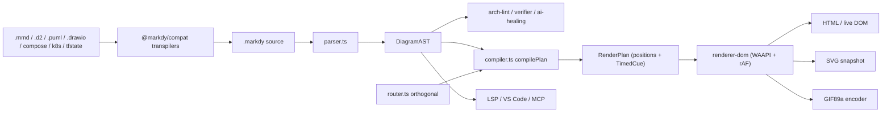
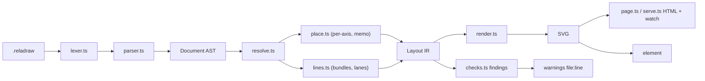
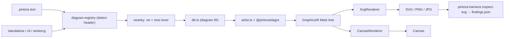
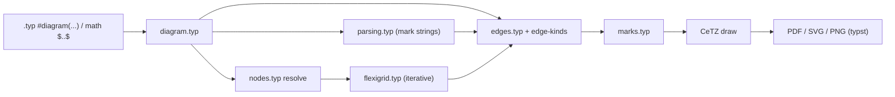

# Weekly scan — diagram tooling (2026-11-20)

Cửa sổ quét: push trong 2026-11-13 → 2026-11-20. Nguồn: GitHub search `topic:{diagram-as-code,dsl,svg-animation,graph-visualization,layout-algorithm,graph-layout,diagrams} pushed:>2026-11-13 stars:>50` + keyword `created:>2026-10-21` (đủ ≥4 ứng viên nên không cần fallback 3 — scan release của mermaid/d2/plantuml…). Cả 4 repo đã clone và đọc source; số star lấy từ search API (API chi tiết từng repo bị chặn trong session này, nên contributors/release date ghi "không xác định" khi git log không cho biết).

## Executive summary

- **markdy-com** là đối thủ trực tiếp gần kymo nhất từ trước tới nay: DSL → animated architecture diagram, có kịch bản animation (`beat` / cue) ngay trong DSL, có compat transpiler Mermaid/D2/PlantUML/draw.io → DSL, có LSP + VS Code + MCP. Nên đọc kỹ cách họ biến "storyboard" thành timeline — kymo hiện chưa có khái niệm này.
- **reladraw** đi theo hướng ngược với auto-layout: vị trí *tương đối* do người viết khai báo (`below app.ui (gap: tight)`, `even with`), engine không bao giờ tự dời box, mà phát **findings** (warning có toạ độ) khi hình có thể đọc sai. Rất gần triết lý "renderer dumb" + alignment resolver của kymo — đáng mượn hệ thống findings và `bundle`/`guide region` cho edge.
- **pintora** (nearley + moo, dagre fork) và **fletcher** (Typst, flexigrid) là nguồn kỹ thuật: pintora vừa sửa hàng loạt bug "keyword lọt vào tên" — bài học trực tiếp cho lexer `.kymo`; fletcher có mini-language cho arrow mark (`"-|>"`, `"hook-->"`) và thuật toán flexigrid giải kích thước cột/hàng lặp đến hội tụ.

Loại sau khi xem: `Goblinmine/homelab-diagram` (YAML → SVG bằng Python nhưng layout hard-code trong `build.py`, tác giả tự nói "not a general tool" — chỉ đáng glance ý tưởng visual encoding "line width = link speed"); `caru-ini/stack-diagram`, `bassnova42/arch-diagram-skill`, `tt-a1i/archify` (agent skill / prompt, không có engine); `andy-frost-2006/microsoft-visio-desktop`, `lanflow-*` (repo spam/binary-bait); `plantuml/plantuml`, `excalidraw` (không có thay đổi đáng kể trong tuần).

## Table of contents

1. [HoangYell/markdy-com](#1--hoangyellmarkdy-com) — animated architecture diagrams-as-code
2. [reladraw/reladraw](#2--reladrawreladraw) — relative-placement diagram language
3. [hikerpig/pintora](#3--hikerpigpintora) — extensible text-to-diagrams (nearley)
4. [fletcher-package/fletcher](#4--fletcher-packagefletcher) — Typst diagrams with arrows

---

## 1 — HoangYell/markdy-com

### §1 Quick context

- **Pitch:** DSL "diagram-native" sinh diagram kiến trúc *có kịch bản animation* (beat/cue, camera `frame`) chạy bằng Web Animations API, không chỉ vẽ tĩnh.
- **Stack:** TypeScript, pnpm monorepo, tsup; `@markdy/core` zero-dep; output DOM+SVG live, SVG snapshot, GIF, HTML offline.
- **Health:** ~107★ (repo tạo 2026-04), v1.5.8, CI GitHub Actions (Node 18/20/22), vitest. Contributors: không xác định.
- **Distribution:** npm (`@markdy/core`, `renderer-dom`, `cli`, `compat`, `mcp-server`, `astro`, `mdx`), VS Code Marketplace + Open VSX.

### §2 Architecture deep-dive

**A. Component inventory**
- `Parser` (`packages/core/src/parser.ts`) — indentation-aware, statement patterns bằng regex, `ParseError(line)`.
- `AST` (`packages/core/src/ast.ts`) — `DiagramAST { meta, styles, nodes, edges, groups, patterns, annotations, beats, diagnostics }`.
- `Compiler` (`packages/core/src/compiler.ts`, 2.4k LOC) — `compilePlan(ast, theme)` → `RenderPlan`: sizing, ranking, ~15 hàm `layout*`, group boundary, `scheduleBeats`.
- `Router` (`packages/core/src/router.ts`) — "collision-aware orthogonal Manhattan router" với port lane multiplexing.
- `Diagnostics` (`core/src/syntax-diagnostics.ts`, `arch-lint.ts`, `verifier.ts`, `ai-healing.ts`) — lint kiến trúc + build "repair prompt" cho agent.
- `Renderer` (`packages/renderer-dom/src/diagram.ts`, `nodes.ts`, `edges.ts`, `sequence.ts`) — DOM node + SVG overlay cho edge, rAF loop.
- `Exporters` (`renderer-dom/src/export/svg-exporter.ts`, `gif-encoder.ts`) — SVG snapshot "Figma-ready", GIF89a encoder tự viết.
- `Compat` (`packages/compat/src/mermaid/mermaid-transpiler.ts`, `infra/{d2,plantuml,drawio,docker-compose,k8s,terraform}-transpiler.ts`) — X → MarkdyScript.
- Tooling: `packages/cli/src/index.ts`, `markdy-language-server/src/index.ts`, `vscode/src/extension.ts`, `mcp-server/`.

**B. Pipeline (happy path)**
1. User chạy `npx @markdy/cli render system.markdy --out diagram.html`.
2. (Tuỳ chọn) `@markdy/compat` transpile `.mmd`/`.d2`/`.drawio` → MarkdyScript text.
3. `parse(source)` → `DiagramAST` (có `diagnostics` non-fatal).
4. `compilePlan(ast, theme)` → `RenderPlan`: node positioned, edge routed, `TimedCue[]` + `BeatRange[]`.
5. `createDiagram()` dựng DOM, tạo WAAPI animation *paused*, rAF loop set `anim.currentTime = sceneMs`.
6. CLI ghi HTML (hoặc SVG snapshot / GIF bằng capture frame).

**C. IR** — plain TS interface, hai tầng rõ ràng: `DiagramAST` (declarative) → `RenderPlan` (lower IR đã có toạ độ + timeline). Đây đúng là "compile to lower IR"; renderer chỉ playback. Mutability giữa pass: không xác định (compiler tạo object mới).

**D. Input language** — line-based + regex statement patterns, block bằng `:` + indent; có "soft-body recovery" khi MDX nuốt indent. Flow chain `A -> B "lbl" -> C`, operator ngữ nghĩa `->` / `<-` (response) / `~>` (async) / `--`. Grammar formal: `docs/SYNTAX.md` dạng prose, không thấy EBNF. Lỗi: `ParseError` có line number + diagnostics riêng (`syntax-diagnostics.ts`, 1.1k LOC).

**E. Layout** — chọn theo `diagramType`: `layoutRanked` (longest-path ranking kiểu Kahn, rank order bằng **barycenter** theo parent, ưu tiên group + declaration order), `layoutTree`, `layoutSwimlane`, `layoutTimeline`, `layoutGantt`, `layoutVenn`, `layoutQuadrant`, `layoutPyramid`, `layoutRadar`, `layoutConstellation`… (README quảng cáo "17 layout engines" — thực chất là template layout theo loại diagram). Edge routing: orthogonal Manhattan có obstacle check + port lane. `computeAdaptiveDimensions` tự suy aspect ratio canvas, snap grid 16px.

**F. Rendering** — backend chính là DOM (div node + SVG edge overlay), **không phải SVG thuần**. Animation: WAAPI, luôn paused, rAF điều khiển `currentTime` để deterministic (họ ghi lại 2 bug WAAPI: `startTime` không đáng tin, cascade `fill:"both"`). SVG export là *snapshot* trạng thái hiện tại; animation di động chỉ qua GIF/HTML.

**G. Extensibility** — `system-vocabulary.ts` + `classifier.ts` map node kind → role → màu/icon; `themes.ts` + `theme-generator.ts`; `patterns` (cue template tái dùng) trong DSL; `stdlib-systems` package. Không có plugin API chính thức.

**H. DX** — CLI 2k LOC, playground có timeline scrubbing + share link (`url-codec.ts`), LSP, VS Code preview `Cmd+K V`, MCP server + skills cho agent.

### §3 Architecture diagram

### §4 Verdict

- **Học cho kymo:** (1) tách `RenderPlan` có timeline (`TimedCue`, `BeatRange`) khỏi geometry — kymo có thể thêm block `beat`/`story` sinh CSS `animation-delay` mà vẫn giữ SVG thuần (lợi thế của kymo: animated SVG self-contained, markdy cần JS runtime). (2) operator ngữ nghĩa `~>` async / `<-` response. (3) compat transpiler Mermaid/D2 → DSL là con đường acquisition rẻ — kymo đã có BPMN, nên cân nhắc Mermaid flowchart. (4) bug list WAAPI là tài liệu tốt nếu playground kymo cần scrubbing.
- **Red flags:** marketing nặng ("17 engines", "self-healing"), nhiều module AI-flavored (`ai-healing`, `drift`, `provenance`) khó đánh giá chất lượng; layout là template theo type, không phải engine tổng quát; SVG export mất animation.
- **Open questions:** router có minimize bend/crossing không hay chỉ né obstacle? Test coverage layout?
- **Verdict:** **study deeper** (animation model + compat).

---

## 2 — reladraw/reladraw

### §1 Quick context

- **Pitch:** ngôn ngữ diagram nơi *bạn nói box nằm đâu* (vị trí tương đối), nằm giữa Mermaid (auto) và draw.io (absolute); engine không tự dời box, chỉ cảnh báo.
- **Stack:** TypeScript, **zero runtime deps**; output SVG, HTML page, custom element `<reladraw-diagram>`.
- **Health:** ~1.2k★ (tạo 2026-09, lên HN), v0.32.0; **không thấy CI workflow hay test dir** trong repo. Không nhận PR (chỉ issue).
- **Distribution:** npm (`reladraw` CLI + lib), CDN element, playground web.

### §2 Architecture deep-dive

**A. Component inventory**
- `Lexer` (`src/lexer.ts`) — `Token { text, quoted, triple, joined, start, end }`, giữ vị trí để formatter copy nguyên văn.
- `Parser` (`src/parser.ts`, 4k LOC) — `parse()` → `Document` (AST trong `src/ast.ts`), `blame()` để chỉ đúng dòng lỗi trong statement nhiều dòng.
- `Resolver` (`src/resolve.ts`, 2.4k) — `resolve(doc) → Layout`: defaults, styles, sizes.
- `Placer` (`src/place.ts`, 2.8k) — tính vị trí từng axis on-demand + memo, phát hiện vòng.
- `Line planner` (`src/lines.ts`, 2.3k) — `planLines`/`planSides`: chọn mặt, fan copy-set, lane routes, curved/square.
- `Renderer` (`src/render.ts`) — `render(layout) → SVG string`, theme (`src/themes.ts`), icons.
- `Checks` (`src/checks.ts`) — `findings(layout, checks)`: overlap, line-crosses-box… có kind bật/tắt.
- `Formatter` (`src/format.ts`), `Grammar`/highlighter (`src/grammar.ts`), `Serve` (`src/serve.ts`), `Page` (`src/page.ts`), `CLI` (`src/cli.ts`).

**B. Pipeline**
1. `reladraw render arch.reladraw -o arch.svg`.
2. `parse()` gom statement (dòng không indent mở statement; dòng indent nối tiếp) → `Document`.
3. `resolve()` → `Layout` (`src/model.ts`: `LayoutNode`, `LayoutEdge`, `LayoutMark`…), gọi `place.ts` + `lines.ts`.
4. `render(layout)` → SVG string; song song `findings()` → warnings in một dòng `file:line: …`.
5. Ghi file (hoặc `--page` HTML; `serve` có watch + reload).

**C. IR** — `Document` (AST) → `Layout` (TS interfaces có `Rect`, `Reach`, `Route`). Toạ độ **per-frame** (con được đặt trong frame của container, page = top frame). Không có lower IR riêng ngoài Layout.

**D. Input language** — hand-written tokenizer + recursive descent dispatch theo keyword đầu statement (`node`, `edge`, `style`, `default`, `guide region`, `bundle`…). Cú pháp: `node app.api "API" below app.ui (gap: tight)`, `right of app (gap: 12) even with app.api`, `edge a -> b from: right to: left via: rclone`. Tên phân cấp bằng dấu chấm = containment. Grammar: `SYNTAX.md` ~2k dòng prose; `grammar.ts` xuất *lexical* vocabulary thành regex một-dòng để sinh TextMate/Vim/Emacs grammar — không có EBNF. Lỗi: `SourceError(message, line)`, message "in the vocabulary of the source", `nearMatch()` gợi ý từ gần đúng.

**E. Layout** — không auto-layout. Mỗi axis của mỗi box đến từ **đúng một** statement (gap đã khai báo, không solver, không push); container = bounding box con + padding. Chu trình phụ thuộc → lỗi kèm danh sách placement. Edge: thẳng mặc định; `path: curved`, `from:/to:` side, `via:` waypoint, `bundle … through channel horizontal` cho các line đi chung một kênh, fan copy-set khi nhiều edge chung đầu. Không crossing minimization (by design).

**F. Rendering** — một backend SVG string; không animation. Theme light/dark + `theme-*` token.

**G. Extensibility** — `style` named, `default edge`, icons tự thêm (SYNTAX "Your own icons"), themes. Không plugin.

**H. DX** — tốt nhất trong 4 repo: `check` (chỉ findings), `format` (căn cột), `serve` (watch, click box → highlight statement, in/out edges), `install-skill` cho agent, error có line chính xác qua `blame`.

### §3 Architecture diagram

### §4 Verdict

- **Học cho kymo:** (1) **findings** sau render (box chồng nhau, line cắt box, text đè text) in `file:line` — kymo nên có `kymo check` tương tự, rất hợp với agent-driven editing. (2) quy tắc "mỗi axis một statement" + phát hiện vòng là cách rõ ràng để spec hoá parent/child anchoring trong `alignment.py`. (3) `bundle`/`guide region channel` = dạng khai báo của trunk-lane staggering mà kymo đang tự suy. (4) `grammar.ts` sinh highlighter cho nhiều editor từ cùng vocabulary — áp dụng cho `docs/DSL.md` ↔ VS Code extension.
- **Red flags:** file 2–4k LOC, không test/CI, "language changing frequently".
- **Open questions:** hiệu năng `place.ts` memo trên diagram lớn?
- **Verdict:** **study deeper** (checks + edge bundles).

---

## 3 — hikerpig/pintora

### §1 Quick context

- **Pitch:** thư viện text-to-diagrams kiểu Mermaid/PlantUML nhưng *plugin-first*: mỗi diagram type là gói parser+artist đăng ký vào registry, chạy browser lẫn Node.
- **Stack:** TypeScript, nearley + moo (fork `@hikerpig/moo`), `@pintora/dagre` + `graphlib`, `@antv/g-svg`/`g-canvas`; output SVG/Canvas/PNG/JPG.
- **Health:** ~1.28k★, core v0.8.1, CI (`ci-check.yml`, `update-tests.yml`), Jest + Percy visual snapshot. Tuần này: 5 fix parser + build Node 26.
- **Distribution:** npm (`@pintora/standalone`, `@pintora/cli`, `target-wintercg`).

### §2 Architecture deep-dive

**A. Component inventory**
- `Core` (`packages/pintora-core/src/diagram-registry.ts`, `config-engine.ts`, `type.ts`, `themes/`) — registry, config, Mark types.
- `Diagrams` (`packages/pintora-diagrams/src/{sequence,er,class,component,activity,gantt,mindmap,dot}/`) — mỗi loại có `parser/*.ne`, `db.ts`, `artist.ts`, `config.ts`.
- `Renderer` (`packages/pintora-renderer/src/renderers/{SvgRenderer,CanvasRenderer,base}.ts`).
- `Standalone` (`packages/pintora-standalone/src/index.ts`) — `registerDiagram` tất cả + entry `render`.
- `Harness` (`packages/pintora-harness/src/{inspection,rendering,review,orchestration}`) — vòng QA layout cho AI agent: `render-svg → inspect-svg (rules.ts, svg-metrics.ts) → capture-browser → summary.json → review.json`.

**B. Pipeline**
1. `pintora render -i er-1.pintora -o out.svg`.
2. Standalone detect header (`erDiagram`, `componentDiagram`…) → chọn diagram trong registry.
3. nearley parser (moo lexer) gọi action ghi vào `db` (IR).
4. `artist` chạy dagre layout (cho graph-like) → **Mark tree** (GraphicsIR: rect/text/path/group).
5. `SvgRenderer`/`CanvasRenderer` vẽ Mark tree qua `@antv/g` → file.

**C. IR** — hai tầng: diagram-specific `db` (mutable, dồn qua action parser) → `GraphicsIR` Mark tree (draw instruction, renderer-agnostic). Đây là "lower IR" thật sự, giống `RenderPlan` của markdy.

**D. Input language** — **nearley grammar** (`.ne`, có `@include` share `whitespace.ne`, `config.ne`, `comment.ne`) + moo lexer theo regex; formal grammar chính là file `.ne`. Commit tuần này (#460–#463): keyword như `left of`, `subgraph`, `classDiagram`, `inherit` bị lexer match *bên trong* tên → syntax error; sửa bằng anchor đầu dòng / bỏ token thừa.

**E. Layout** — dagre (Sugiyama: rank, crossing minimization, coordinate assignment) cho component/activity/er/class/dot; sequence/gantt/mindmap dùng layout riêng trong artist. Edge: polyline/spline theo dagre point.

**F. Rendering** — pluggable renderer (SVG, Canvas) trên cùng Mark tree; không animation.

**G. Extensibility** — `pintora.registerDiagram(name, { parser, artist, configKey })` ("three-piece pattern" trong `.ai/docs/patterns`); theme token qua `getConfig().themeConfig`.

**H. DX** — live editor web, CLI, WinterCG target (edge runtime), `.ai/` docs + skill "add-new-diagram" cho agent.

### §3 Architecture diagram

### §4 Verdict

- **Học cho kymo:** (1) bug class "contextual keyword trong tên" — nên thêm case vào `conformance/corpus` (tên node chứa `layout`, `region`, `edge`…) để khoá cả Python và JS. (2) harness tách *structural SVG inspection* (metrics + rules → `findings.json`) khỏi visual judge — áp dụng được cho mermaid-bench và golden test của kymo. (3) Mark tree trung gian cho phép thêm Canvas backend rẻ.
- **Red flags:** phụ thuộc `@antv/g` 0.5 cũ, fork riêng dagre/moo; core description "Awesome functions" — maintenance mỏng.
- **Verdict:** **glance only** (harness + parser fixes).

---

## 4 — fletcher-package/fletcher

### §1 Quick context

- **Pitch:** package Typst vẽ node-và-arrow (commutative diagram, FSM, flowchart) với grid đàn hồi và arrow-mark mini-language, chất lượng typographic ngang LaTeX tikz-cd.
- **Stack:** Typst ≥0.15 trên CeTZ; output = bất kỳ gì Typst xuất (PDF/SVG/PNG).
- **Health:** ~1.16k★, v0.6.0 (bump compiler 0.15 tuần này), CI (`ci.yaml`, `site.yaml`), ~168 test snapshot PNG. Contributors: không xác định.
- **Distribution:** Typst Universe (`@preview/fletcher:0.6.0`).

### §2 Architecture deep-dive

**A. Component inventory**
- `diagram()` (`src/diagram.typ`) — entry; nhận args hoặc **math equation** và `extract-nodes-and-edges-from-equation`.
- `Parsing` (`src/parsing.typ`) — parse chuỗi mark `"-|>"`, `"--"`, `"=="`, `"~"`, `"hook-->"` thành style dict (`EDGE_FLAGS`, `LINE_ALIASES`, `MARK_SYMBOL_ALIASES`).
- `Flexigrid` (`src/flexigrid.typ`) — hệ toạ độ cell ↔ physical.
- `Nodes` (`src/nodes.typ`) — `resolve-node-shape/styles/body-size`, `resolve-enclose-node`.
- `Edges` (`src/edges.typ`, `edge-kinds.typ`: `line`/`arc`/`poly`…, `paths.typ`, `intersection.typ`) — snapping vào outline node, label anchor, crossing fill.
- `Marks` (`src/marks.typ`, `default-marks.typ`) — arrowhead định nghĩa bằng dữ liệu.
- `Shapes` (`src/shapes.typ`).

**B. Pipeline**
1. User `typst compile doc.typ` có `#diagram(node((0,0), [A]), edge("-|>"), …)`.
2. `diagram()` chuẩn hoá args (hoặc tách `&`/`\` của math thành grid).
3. Resolve style node/edge; đo body size.
4. Resolve flexigrid: đặt "rod" vào flexiline từng axis, nới cell, lặp tới hội tụ.
5. Snap edge vào outline, vẽ marks/labels bằng CeTZ → output Typst.

**C. IR** — Typst dictionary (immutable, functional), node/edge dict được enrich qua mỗi `resolve-*`. Không lower IR riêng ngoài CeTZ draw commands.

**D. Input language** — embedded DSL trong Typst (function call + string mark mini-language); math mode dùng ma trận `&`/`\` làm layout. Error: `assert` + Typst panic.

**E. Layout** — user-specified grid coordinates (có fractional), kích thước cột/hàng tự giải (flexigrid iterative, liên tục theo input). Edge: line / arc (`bend: -40deg`) / poly vertices / loop; không crossing minimization.

**F. Rendering** — Typst/CeTZ; không animation.

**G. Extensibility** — mark tuỳ biến bằng dict, `edge.with(...)` partial, shape function tuỳ biến.

**H. DX** — manual PDF + site, debug levels (`debug.typ`) vẽ grid/anchor.

### §3 Architecture diagram

### §4 Verdict

- **Học cho kymo:** (1) arrow-mark string `"<|--o"` là cách compact mô tả đầu/thân edge — kymo có thể dùng cho edge style thay vì nhiều attribute. (2) flexigrid: auto-size cột/hàng của `layout { grid }` theo nội dung bằng iteration, giữ tính liên tục — đáng so với auto-layout frame của `layout.py`. (3) `crossing: true` vẽ "gap" khi edge cắt nhau — trick visual rẻ cho SVG.
- **Red flags:** không có (codebase gọn, test nhiều); nhưng gắn chặt Typst runtime.
- **Verdict:** **glance only** (mượn idea, không tái dùng code).
