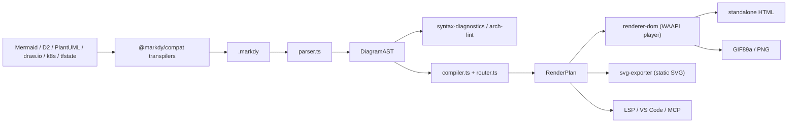
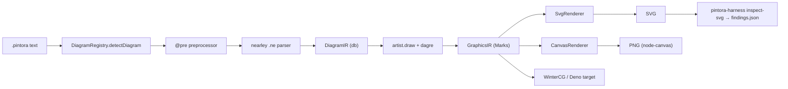
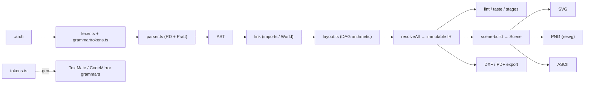
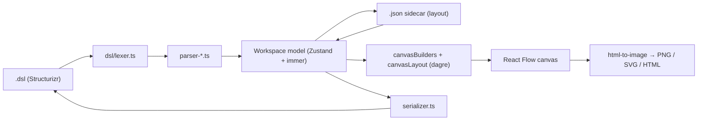

# Weekly scan — diagram tooling (2026-11-21)

Cửa sổ quét: `pushed:>2026-11-14` (topic search) + `created:>2026-10-22` (keyword search).
Nguồn: GitHub search API (`topic:diagram-as-code|dsl|svg-animation|graph-visualization|layout-algorithm`, `diagram created:>…`). Mọi repo deep-dive đều được clone `--depth 1` và đọc source trực tiếp; số stars lấy từ search API ngày 2026-11-21. Repo metadata API (contributors, releases) bị chặn trong session này → các trường đó ghi "không xác định" khi không suy ra được từ repo.

## Executive summary

- **Đối thủ trực tiếp xuất hiện: Markdy** (`HoangYell/markdy-com`) — "animated architecture diagrams as code", đúng positioning của kymo. Khác biệt cốt lõi: animation là *timeline có beat/cue* chạy bằng Web Animations API trong DOM, còn SVG export là **tĩnh**. Kymo vẫn giữ lợi thế "animated SVG standalone"; nhưng cú pháp `beat`/`frame`/`stagger` của Markdy đáng mượn.
- **Hai pattern kiểm chứng đáng copy:** Pintora có `pintora-harness` (render → đo metrics SVG → findings JSON, ví dụ text quá sát viewBox) — một lớp lint *hình học* trên output, bổ sung cho golden byte-for-byte của kymo. ArchLang có ADR "relational placement = arithmetic theo DAG, không solver" — đúng triết lý deterministic của kymo, đáng đọc như tài liệu thiết kế.
- **c4hero** chứng minh round-trip Structurizr DSL ↔ visual canvas khả thi với layout lưu ở **sidecar JSON** (DSL không chứa toạ độ) + ~30 file `*-roundtrip.test.ts`. Liên quan trực tiếp nếu kymo editor muốn edit kéo-thả mà vẫn giữ `.kymo` sạch.

## Table of contents

1. [Candidates đã xét](#candidates-đã-xét)
2. [Markdy — `HoangYell/markdy-com`](#1-markdy--hoangyellmarkdy-com)
3. [Pintora — `hikerpig/pintora`](#2-pintora--hikerpigpintora)
4. [ArchLang — `ChanMeng666/archlang`](#3-archlang--chanmeng666archlang)
5. [c4hero — `c4hero/c4hero`](#4-c4hero--c4heroc4hero)

## Candidates đã xét

| Repo | ★ | Lý do | Quyết định |
|---|---|---|---|
| HoangYell/markdy-com | 107 | Animated arch DSL, compat Mermaid/D2/PlantUML/draw.io | **Deep-dive** |
| hikerpig/pintora | 1282 | Text-to-diagram, nearley parser, GraphicsIR, push 2026-11-19/21 | **Deep-dive** |
| ChanMeng666/archlang | 89 | Floor-plan DSL (adjacent), compiler + lint + ADR rất kỹ | **Deep-dive** |
| c4hero/c4hero | 62 | Structurizr DSL ↔ canvas round-trip | **Deep-dive** |
| Goblinmine/homelab-diagram | 1507 | YAML → SVG/PNG; README tự nhận layout hand-placed trong `build.py`, không phải tool tổng quát | Glance: ý tưởng *line width = link speed* hay về visual encoding |
| caru-ini/stack-diagram | 2685 | Agent skill sinh arch diagram có logo chính hãng | Glance: là skill/prompt package, ít engine |
| plantuml/plantuml | 13.4k | Push thường xuyên | Ecosystem, không có thay đổi kiến trúc đáng note tuần này |
| goadesign/model | 469 | Arch model trong Go code | Đã biết, ít thay đổi |
| justdeko/kuiver | 130 | Compose Multiplatform directed-graph viewer | Glance |
| iiwish/kgdiff | 62 | Visual diff cho knowledge graph | Glance: ý tưởng semantic diff |
| *Loại*: Visio "desktop" repos (spam/malware pattern), Qiuner/birdview (AI code-map, không phải diagram engine), drawsvg (generic SVG lib) | | | Ignore |

---

## 1. Markdy — `HoangYell/markdy-com`

### §1 Quick context

- **Pitch:** DSL diagram kiến trúc *có kịch bản*: chia thành `beat`, mỗi beat là chuỗi cue animation (show/frame/glow) phát 60fps — storyboard chứ không chỉ hình.
- **Stack:** TypeScript monorepo (pnpm), `@markdy/core` zero-dep; renderer DOM + WAAPI; output HTML player, SVG tĩnh, GIF89a, PNG.
- **Health:** 107★, tạo 2026-04-05, v1.5.8, CI (`ci.yml`, `release.yml`, `publish-vscode.yml`), 37 file test. History bị squash (1 commit) → contributors không xác định.
- **Distribution:** npm (`@markdy/core`, `@markdy/cli`, `@markdy/mcp-server`), VS Code/Open VSX, web playground.

### §2 Architecture deep-dive

**A. Component inventory**
- `Parser` (`packages/core/src/parser.ts`, 1347 LOC) — DSL → `DiagramAST`.
- `AST/RenderPlan types` (`packages/core/src/ast.ts`) — 18 `DiagramType` (architecture, sequence, gantt, venn, …).
- `Compiler` (`packages/core/src/compiler.ts`, 2371 LOC) — layout + cue scheduling → `RenderPlan`.
- `Router` (`packages/core/src/router.ts`) — orthogonal Manhattan router, port lanes, obstacle avoidance.
- `Syntax diagnostics / arch-lint / ai-healing` (`packages/core/src/*.ts`) — lint và sinh "repair prompt" cho LLM.
- `Renderer DOM` (`packages/renderer-dom/src/diagram.ts`, `edges.ts`, `nodes.ts`, …) — playback.
- `Exporters` (`packages/renderer-dom/src/export/{svg,gif,png}-exporter.ts`).
- `Compat transpilers` (`packages/compat/src/mermaid/`, `infra/{d2,plantuml,drawio,docker-compose,k8s,terraform}-transpiler.ts`) — X → MarkdyScript.
- `CLI` (`packages/cli/src/index.ts`), `LSP` (`packages/markdy-language-server`), `MCP server`, `astro`/`mdx` integrations.

**B. Pipeline (happy path)**
1. User chạy `markdy render system.markdy --out d.svg`.
2. `loadSceneFromFile` → `parse(source)` → `DiagramAST` (nodes, edges, groups, patterns, beats, diagnostics).
3. `compile(ast)` → `assignRanks` + `layoutRanked`/`layoutTree`/… → `RenderPlan` (toạ độ, edge đã route, cue có timing).
4. Nhánh `.svg` → `renderPureVectorSvg(plan)`; nhánh `.html` → `buildStandaloneHtml` (nhúng renderer); không `--out` → mở playground local.
5. File ghi ra đĩa.

**C. IR:** hai tầng rõ ràng — `DiagramAST` (plain TS types, khai báo) → `RenderPlan` (đã layout + timeline). Đây chính là "compile to lower IR". Không thấy evidence về immutability enforcement.

**D. Input language:** line-oriented, indentation-aware, regex statement matching (`TOP_LEVEL_KEYWORDS_RE`, `tokenizeFlowChain`). Có "soft-body recovery" khi MDX xoá indent. `ParseError(lineNumber)` + `syntax-diagnostics.ts` (1114 LOC). Grammar formal: không xác định (có `docs/SYNTAX.md`, không thấy EBNF). Flow chain `A -> B "lbl" -> C`, response `<-`, async `~>`.

**E. Layout:** hierarchical tự viết: longest-path ranking (Kahn, bỏ qua edge `response`), **barycenter** sort theo parent rank trước + adjacent-swap giảm crossing, rồi đặt cột/hàng theo canvas adaptive (`computeAdaptiveDimensions`). Có layout riêng cho tree, loop, quadrant, swimlane, pyramid, constellation. Edge: orthogonal + rounded corner (`buildSmoothSvgPath`), **port lane multiplexing** (`allocatePortLanes`) chia đều điểm nối trên cạnh box.

**F. Rendering/animation:** DOM `
` cho node + `<svg>` overlay cho edge. Animation = WAAPI keyframes **luôn paused**, rAF loop set `anim.currentTime = sceneMs` để deterministic (né bug `fill:"both"` cascade). `frame` cue = camera transform layer. SVG export không chứa `<animate>`/`@keyframes` (grep 0 match) → SVG tĩnh; motion chỉ có ở HTML/GIF.

**G. Extensibility:** node kind → role → icon/colour trong `system-vocabulary.ts`; themes (`themes.ts`, `theme-generator.ts`); `pattern` = macro cue tái sử dụng; `stdlib-systems` package. Không thấy plugin API công khai.

**H. DX:** CLI có `lint/fmt/render/import/diff/explain/verify/drift/c4/...`; VS Code live preview (`Cmd+K V`), LSP, URL-hash share (`url-codec.ts`), playground có timeline scrub.

### §3 Architecture diagram

### §4 Verdict

- **Học cho kymo:** (1) cú pháp `beat "name": show $nodes stagger=60ms / frame A B zoom=1.12` — mô hình *storyboard nhiều beat* là bước kế tiếp tự nhiên cho animated SVG của kymo (có thể compile beat → CSS `animation-delay` theo nhóm). (2) `allocatePortLanes` ≈ fan-in staggering của `alignment.py`; so sánh để xem có nên phân lane theo cả source lẫn target. (3) Ý tưởng `<-` response lưu theo hướng data-flow và bị loại khỏi ranking — tránh response edge đảo rank.
- **Red flags:** marketing-heavy README, "AI self-healing", "clean-room re-engineered" router; history squash; 18 diagram type trong một compiler 2.3k LOC → mỏng từng loại.
- **Open questions:** export SVG có bao giờ mang animation không? Compat transpiler mất bao nhiêu ngữ nghĩa?
- **Verdict:** **study deeper** (competitor + beat DSL).

---

## 2. Pintora — `hikerpig/pintora`

### §1 Quick context

- **Pitch:** thư viện text-to-diagram kiểu Mermaid/PlantUML nhưng **modular**: mỗi diagram là plugin (parser + artist), vẽ ra GraphicsIR trung lập rồi mới tới SVG/Canvas.
- **Stack:** TypeScript, nearley + moo (grammar `.ne`), `@pintora/dagre`, d3-shape/scale, `@antv/g-svg`/canvas; output SVG, Canvas, PNG (CLI qua jsdom + node-canvas).
- **Health:** 1282★, từ 2021, diagrams v0.8.2, commit mới nhất 2026-11-19 (fix classDiagram), Jest + codecov + harness e2e.
- **Distribution:** npm (`@pintora/standalone`, `@pintora/cli`), Deno/WinterCG target, web demo.

### §2 Architecture deep-dive

**A. Component inventory**
- `DiagramRegistry` (`packages/pintora-core/src/diagram-registry.ts`) — đăng ký diagram, `detectDiagram` bằng regex header (mặc định sequence).
- `GraphicsIR / Mark` (`packages/pintora-core/src/types/graphics.ts`) — Group/Rect/Text/Path/Marker…
- `Config engine / @pre` (`pintora-core/src/config-engine.ts`, `pre.ts`) — block `@pre … @endpre` merge config + StyleEngine `@bindClass`.
- `Diagram modules` (`packages/pintora-diagrams/src/{sequence,er,component,activity,mindmap,gantt,dot,class}/`) — mỗi cái có `parser/*.ne`, `db.ts` (DiagramIR), `artist.ts`, `config.ts`, `event-recognizer.ts`.
- `Renderers` (`packages/pintora-renderer/src/renderers/{SvgRenderer,CanvasRenderer}.ts`).
- `CLI` (`packages/pintora-cli/src/render-impl.ts`, `subprocess-render/`).
- `Harness` (`packages/pintora-harness/src/{rendering,inspection,review,orchestration}`).
- `WinterCG target` (`packages/pintora-target-wintercg`, có `deno.json`, fonts bundle).

**B. Pipeline**
1. `pintora render -i x.pintora -o x.svg`.
2. `diagramRegistry.detectDiagram(text)` chọn module theo `pattern`.
3. `ParserWithPreprocessor` tách `@pre`, nearley parse → ghi vào `db` → **DiagramIR**.
4. `artist.draw(diagramIR, config)` → layout (dagre cho ER/component/class/dot; tính tay cho sequence/gantt) → **GraphicsIR**.
5. `SvgRenderer` (`@antv/g-svg` trong jsdom) → SVG string / Canvas → PNG.

**C. IR:** hai tầng: DiagramIR (per-diagram, trong `db` singleton **mutable**, có `clear()`) → GraphicsIR (cây Mark, generic). Đây là "lower IR" thật sự: mọi renderer chỉ biết Mark.

**D. Input language:** parser generator **nearley** (Earley) + lexer moo, grammar `.ne` có `@include` các mảnh dùng chung (`whitespace.ne`, `config.ne`, `bind.ne`). Grammar formal = chính file `.ne`. Error: không xác định chi tiết (CHANGELOG cho thấy nhiều bug parse edge-case → grammar Earley khá giòn với keyword trong tên).

**E. Layout:** hierarchical qua fork `@pintora/dagre` + `@pintora/graphlib` (Sugiyama, crossing minimization của dagre); edge polyline/spline qua d3-shape. Sequence/gantt tự đặt toạ độ.

**F. Rendering:** pluggable renderer pattern (`IRenderer`, `BaseRenderer`) — SVG và Canvas từ cùng GraphicsIR. Không có animation. Có `diagram-event` (event recognizer map click → item data) cho tương tác.

**G. Extensibility:** `registerDiagram(name, {pattern, parser, artist, configKey})` — plugin system rõ ràng; có skill `.ai/skills/add-new-diagram`; themes trong `pintora-core/src/themes`; `@bindClass` gán style theo class.

**H. DX:** CLI, docs site, `AGENTS.md` + ADR trong `.ai/docs/adr`; **harness** CLI: `render-svg → inspect-svg (metrics.json, findings.json) → capture-browser → review-case → apply-review`, chạy theo `--suite smoke`. Rule hiện tại còn nhỏ (`rules.ts`: text cách viewBox edge < 4px → warning).

### §3 Architecture diagram

### §4 Verdict

- **Học cho kymo:** (1) **harness inspect-svg**: parse SVG output → metric snapshot → rule → findings. Kymo có golden byte-for-byte (phát hiện *thay đổi*) nhưng chưa có lint *chất lượng hình học* (label chạm viewBox, chồng chéo). Một `tests/_svg_inspect.py` chạy trên `samples/` là low-cost, high-value. (2) GraphicsIR tách layout khỏi backend — tương tự cách kymo có nhiều emitter; đáng xem nếu muốn Figma/Excalidraw dùng chung một IR thấp hơn `Diagram`.
- **Red flags:** `db` singleton mutable (không reentrant); phụ thuộc fork dagre.
- **Verdict:** **glance → study harness** cụ thể.

---

## 3. ArchLang — `ChanMeng666/archlang`

### §1 Quick context

- **Pitch:** "floor plans as code" — DSL mặt bằng kiến trúc biên dịch ra bản vẽ có kích thước, kèm lint hình học (phòng không tới được, cửa lệch tường) có mã lỗi + fix máy áp dụng được.
- **Stack:** TypeScript zero-dep core; optional `@resvg/resvg-js` (PNG), `pdfkit` (PDF); output SVG/PNG/DXF/PDF/ASCII.
- **Health:** 89★, tạo 2026-06-24, v1.66.0, push 2026-11-21, 13 workflow CI (ci, nightly, eval-*, codeql), 662 file test. Single maintainer, viết cùng AI agent (README tự khai).
- **Distribution:** npm `@chanmeng666/archlang` (bin `arch`), MCP server (hosted + local), VS Code/Open VSX, playground.

### §2 Architecture deep-dive

**A. Component inventory**
- `Lexer` (`src/lexer.ts`) + `token table` (`src/grammar/tokens.ts`) — nguồn sinh TextMate/CodeMirror grammar.
- `Parser` (`src/parser.ts`, 2571 LOC) — recursive descent + `expr.ts` (Pratt) cho biểu thức.
- `Element registry` (`src/registry.ts`, `src/elements/*.ts`) — room, wall, door, window, stair, furniture…
- `Layout` (`src/layout.ts`) — relational placement.
- `IR / resolve` (`src/ir.ts` + `src/ir/{expand,checks,groups,sheet}.ts`).
- `Scene build` (`src/scene-build.ts`, `scene.ts`) → `Backends` (`src/backends/{svg,png,ascii}.ts`), `Export` (`src/export/{dxf,pdf}.ts`).
- `Lint` (`src/lint/`, `src/lint.ts`), `Taste` (`src/taste/`), `Stages` (`src/stages.ts`), `Repair/Fix` (`repair.ts`, `fix-apply.ts`), `Impact/Lock` (`impact.ts`, `lock.ts`), `LSP` (`lsp.ts`).

**B. Pipeline**
1. `arch compile plan.arch -o plan.svg --json`.
2. `parse(src, BUILTIN_REGISTRY)` (memo) → AST + diagnostics.
3. `link` (resolve `import` qua `World` — pha I/O duy nhất).
4. `resolveAll` → **IR immutable** mới (grid-snap, gán id, host opening, semantic check), mỗi `level` một ResolvedPlan.
5. `scene-build` → `renderSvg(scene)` (mỗi storey một page; error → `svg = ""`, warning không chặn).
6. Ghi SVG; `--json` trả diagnostics máy đọc được.

**C. IR:** AST → IR (ghi rõ "NEW immutable IR, input AST never mutated") → Scene → backend. Có step meter (`MAX_EVAL_STEPS`) chống plan vô hạn. Rõ ràng là multi-tier lowering.

**D. Input language:** hand-written recursive descent (ADR 0001 giải thích vì sao không dùng Lezer/tree-sitter: zero-dep, byte span chính xác, error recovery bằng `ErrorNode` + resync ở đầu statement). Grammar formal: không thấy EBNF; `docs/language-reference.md` (3.9k dòng) + token table + drift test. Error: mã ổn định (`E_LAYOUT_CYCLE`, `W_NO_ENTRANCE`…), `docs/error-codes.md`, fix có thể áp dụng tự động (ADR 0011).

**E. Layout:** user-specified toạ độ là mặc định; sugar `right-of/below/align/gap` giải bằng **topological pass + closed-form arithmetic** rồi grid-snap (ADR 0004 — từ chối optimizer/force solver vì phá determinism byte-identical). Không phải graph layout, không edge routing.

**F. Rendering:** Scene trung gian → nhiều backend (SVG, PNG qua resvg, ASCII, DXF, PDF). Không animation. Output "byte for byte" deterministic.

**G. Extensibility:** element = 1 module đăng ký vào registry (không cần regenerate grammar); themes (`theme.ts`); overlays (`overlays/`); 35 ADR.

**H. DX:** CLI thiết kế như agent interface (ADR 0015: `spec`, `context`, `describe --json`, `validate --stage`, `finish`, `impact --lock`); LSP + VS Code; playground share bằng URL hash.

### §3 Architecture diagram

### §4 Verdict

- **Học cho kymo:** (1) ADR 0004 gần như mô tả `alignment.py` — dùng làm template để kymo viết ADR riêng cho resolver 5-pass. (2) **Token table → sinh TextMate grammar + drift test**: kymo có `docs/DSL.md` EBNF và VS Code extension; sinh grammar từ một nguồn sẽ chặn drift giữa Python/JS/extension. (3) Mã lỗi ổn định + `--json` diagnostics + `validate --stage` — hữu ích cho MCP `kymo-mcp`. (4) `impact --lock`: chứng minh chỉnh một phần tử không dịch chuyển phần còn lại — mapping tốt sang golden diff.
- **Red flags:** 57k LOC chỉ ở `src/` top-level cho một single-maintainer AI-written repo, v1.66 sau 5 tháng → churn cao, over-engineering.
- **Verdict:** **study deeper** (ADR + DX), không phải layout.

---

## 4. c4hero — `c4hero/c4hero`

### §1 Quick context

- **Pitch:** canvas kéo-thả cho C4 model nhưng file trên đĩa vẫn là **Structurizr DSL thuần**, round-trip hai chiều; local-first, không backend.
- **Stack:** React 19 + TS, Vite, Zustand + immer, `@xyflow/react`, `@dagrejs/dagre`, CodeMirror 6; output `.dsl` + sidecar JSON, PNG/SVG/HTML export.
- **Health:** 62★, Apache-2.0, v0.5.0 (CHANGELOG), push 2026-11-20, CI + Vitest + Playwright e2e.
- **Distribution:** web app (app.c4hero.com, Vercel static); không npm/CLI.

### §2 Architecture deep-dive

**A. Component inventory**
- `Lexer/Parser` (`src/lib/dsl/lexer.ts`, `parser.ts`, `parser-{model,relationship,styles,views,deployment}.ts`).
- `Serializer` (`src/lib/dsl/serializer.ts`) — Workspace → DSL "clean, idiomatic".
- `Auto views` (`src/lib/dsl/auto-views.ts`), `include/wildcard` (`includeResolver.ts`, `wildcard.ts`).
- `Domain model` (`src/types/model.ts`) — Workspace → model + views.
- `Store` (`src/store/workspace.ts` + 11 slices) — Zustand/immer, snapshot undo.
- `Canvas builders` (`src/components/canvas/canvasBuilders.ts`, `deploymentBuilders.ts`, `handleSlots.ts`) — view → React Flow nodes/edges.
- `Layout` (`src/lib/canvasLayout.ts`) — dagre + boundary clusters.
- `Export` (`src/lib/exportUtils`, `htmlExport.ts`), `File IO` (`fileIO.ts`, `folderIO.ts`), `AI BYOK` (`src/lib/ai/`).

**B. Pipeline**
1. User mở folder/`.dsl` (File System Access API).
2. `lexer → parser*` → `Workspace`; `auto-views` bổ sung view thiếu.
3. `canvasBuilders` chiếu view active thành nodes/edges; vị trí từ sidecar, thiếu thì `canvasLayout` (dagre).
4. Edit trên canvas → immer draft mutation + undo snapshot.
5. Save: `serializer` → `.dsl`; toạ độ hand-authored → `.json` sidecar. Export PNG/SVG qua `html-to-image`.

**C. IR:** `Workspace` typed model là source of truth, views là projection (id list + per-node layout). Mutable qua immer drafts (structural sharing). Không có lower IR.

**D. Input language:** không phải DSL mới — parser Structurizr tự viết (lexer + recursive descent chia theo khối). Kiểm chứng bằng `structurizr-conformance.test.ts`, `view-key-conformance.test.ts`, fuzz (`fuzz/generateWorkspace.ts`) và ~15 file `*-roundtrip.test.ts`. Error reporting: CodeMirror lint (`@codemirror/lint`) — chi tiết không xác định.

**E. Layout:** dagre (Sugiyama) cho auto, người dùng ghim vị trí; boundary cluster cho C4 container. Edge routing do React Flow edge components (`components/canvas/edges/`) — loại cụ thể không xác định.

**F. Rendering:** single backend React Flow DOM; export raster/SVG bằng `html-to-image` (snapshot DOM) → SVG không "sạch". Không animation.

**G. Extensibility:** tag-style slice, theme qua CSS custom properties (`--color-status-*`), templates; không có plugin system.

**H. DX:** browser-only, command palette, keyboard shortcuts, CodeMirror source view, autosave localStorage.

### §3 Architecture diagram

### §4 Verdict

- **Học cho kymo:** (1) **Toạ độ ở sidecar, ngữ nghĩa ở DSL** — nếu `packages/editor` cho kéo-thả, đây là cách giữ `.kymo` diffable; ngược lại kymo đã có `at`/layout trong DSL nên cần quyết định rõ (ADR). (2) Bộ test `*-roundtrip` + fuzz generator: kymo có BPMN export/import conformance, nhưng chưa thấy fuzz `.kymo → model → .kymo`. (3) Bug fix "`include *` không được expand khi save" — bài học: serializer phải giữ *intent* (wildcard), không giữ *kết quả*.
- **Red flags:** SVG export qua DOM snapshot; Sentry + analytics trong app "local-first".
- **Verdict:** **glance only**, đọc riêng serializer + roundtrip tests nếu làm editor.
