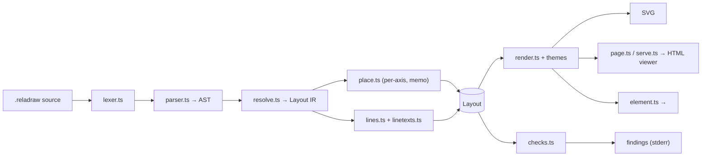
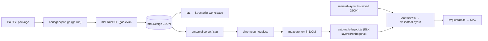
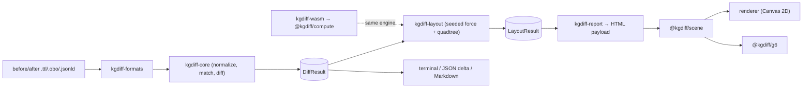

# Weekly scan — diagram tooling (2026-11-22)

| Field       | Value                                                                 |
|-------------|-----------------------------------------------------------------------|
| Window      | `pushed:>2026-11-15` (topic search) · `created:>2026-10-23` (keyword) |
| Sources     | `gh api search/repositories` + shallow clone & đọc code của từng repo |
| Status      | Automated scout — chưa review bởi người                               |

## Executive summary

- **reladraw** (TS, ★1.2k, v0.32.0 ngày 18/11) là phát hiện đáng giá nhất tuần: DSL *relative placement* ("`right of app (gap: 12) even with app.api`"), **không** auto-layout, **không** auto-route — thay vào đó một pass `checks` đo layout đã giải và in *findings* (overlap, line-through-box). Triết lý "draw what's written + lint the picture" rất gần với `alignment.py` của kymo và đáng study sâu.
- **goadesign/model** (Go, C4) vừa chuyển sang pipeline "measure → ELK một lần → **validate** → draw, không repair" và thêm `mdl svg` headless qua chromedp. Ý tưởng *`ValidatedLayout` chỉ được tạo bởi geometry checks* là pattern type-level đáng mượn.
- **kgdiff** (Rust + WASM + TS, ★62 nhưng engineering rất dày) cho thấy cách giữ **Rust ↔ TS byte-identical** bằng conformance corpus + quy tắc "chỉ dùng `+ − × ÷ √`" — đúng bài toán Python↔JS parity của kymo. `homelab-diagram` chỉ đáng glance về visual grammar (line width = link speed).

Loại khỏi shortlist: `Qiuner/birdview` (agent skill/architecture-contract, renderer mỏng), `hikerpig/pintora` (đã cover trong strategy notes), `plantuml/plantuml` (không có release notable), các repo "Microsoft Visio desktop" (spam), `caru-ini/stack-diagram` / `arch-diagram-skill` (agent prompt, không phải engine).

## Table of contents

1. [reladraw/reladraw](#1-reladrawreladraw) — study deeper
2. [goadesign/model](#2-goadesignmodel) — study deeper (phần layout validation)
3. [iiwish/kgdiff](#3-iiwishkgdiff) — study deeper (phần determinism/conformance)
4. [Goblinmine/homelab-diagram](#4-goblinminehomelab-diagram) — glance only

---

## 1. reladraw/reladraw

### §1 — Quick context

- **Pitch:** DSL diagram nơi *bạn nói vật nằm đâu* (relative), tool không bao giờ tự di chuyển box hay tự route line — chỉ cảnh báo.
- **Stack:** TypeScript, **zero runtime deps**; output SVG, single-file HTML page, custom element `<reladraw-diagram>`.
- **Health:** ★1205, 33 forks, release 0.32.0 (2026-11-18), ~28k LOC `src/`. **Không thấy** thư mục test hay `.github/workflows` trong repo. PR không được nhận (issue-only).
- **Distribution:** npm (`reladraw` bin), jsDelivr cho element, playground GitHub Pages.

### §2 — Architecture deep-dive

**A. Component inventory**
- `Lexer` (`src/lexer.ts`) — `tokenizeLine()` per line, giữ `start/end` offset để formatter copy nguyên token.
- `Grammar` (`src/grammar.ts`) — `STATEMENT_KEYWORDS` (node, edge, style, default, point, region, bundle, guide…), `RELATION_WORDS`, regex `PATTERNS` dùng chung cho highlighter.
- `Parser` (`src/parser.ts`, 4k LOC) — gom statement nhiều dòng theo bracket depth → `Stmt[]` (`src/ast.ts`).
- `Resolver` (`src/resolve.ts`) — expand `each`, styles/defaults, icons, build tree `LayoutNode`, gọi placer + line planner.
- `Placer` (`src/place.ts`) — giải vị trí theo từng trục, memoized, phát hiện cycle.
- `Lines` (`src/lines.ts`) — route mỗi edge chỉ từ thông tin statement của nó (`from:/to:/via:`).
- `LineTexts` (`src/linetexts.ts`) — đặt label trên line.
- `Checks` (`src/checks.ts`) — findings: `text-overlap`, `text-overflow`, `edge-node-overlap`, crossings (mặc định off).
- `Renderer` (`src/render.ts`) + `Themes` (`src/themes.ts`) + `Measurer` (`src/measure.ts`, mặc định `monospaceMeasurer`).
- `Formatter` (`src/format.ts`), `Server/Viewer` (`src/serve.ts`, `src/page.ts`), `CLI` (`src/cli.ts`), `Element` (`src/element.ts`).

**B. Happy path**
1. User chạy `reladraw render arch.reladraw -o arch.svg` (`cli.ts`).
2. `parse(text)` → `Document` (list `Stmt`), lỗi là `SourceError(message, line)`.
3. `resolve(doc)` → `Layout`: build tree, `Placer` tính từng axis on-demand, `planLines` route edges.
4. `render(layout)` → chuỗi SVG; song song `findings(layout, checks)` đo trên **cùng** layout.
5. CLI ghi SVG, in warnings một dòng (`12: line crosses "db" by 4px`).

**C. IR** — TS `interface` thuần (`LayoutNode`, `LayoutEdge`, `Layout` trong `model.ts`). AST → Layout là một bước "lower"; trong `place.ts` mọi đại lượng "worked out on demand and remembered" (memo cache), tức IR được fill dần chứ không immutable. Không có IR thứ ba.

**D. Input language** — hand-written line-oriented lexer + recursive parser; statement có thể kéo nhiều dòng khi bracket mở. Không có EBNF; `SYNTAX.md` (~2k dòng) là spec bằng prose. Error: message nêu đúng dòng gây lỗi trong statement nhiều dòng (`blame()`), lỗi cycle in ra chuỗi placement tạo vòng.

**E. Layout** — **user-specified relative**: `right of X (gap: tight|wide|N)`, `even with`, `above-left of`, offset số (`5 below gateway 22 right of gateway`). Mỗi axis của mỗi box đến từ *đúng một* statement; container = outline children + padding, frame-local coordinates. Edge: straight mặc định, `path: square|curved`, `corners: rounded`, waypoint `via: parser top, renderer top`, side spreading khi nhiều đầu chung một cạnh. **Không** crossing minimization, không obstacle avoidance — cố ý ("adding a box elsewhere never moves it").

**F. Rendering** — SVG duy nhất; HTML page có CSS `@keyframes` (dash-flow `run`, `lit` highlight) chỉ trong viewer, có `prefers-reduced-motion`. Không pluggable emitter.

**G. Extensibility** — `style`/`default` statements, theme tokens (`theme-primary-subtle`), `icon` statement đọc file, shape keyword (`document`, venn, erd marks). Không plugin system.

**H. DX** — rất mạnh: `check`, `format` (căn cột), `serve` (fs.watch hot reload, click box → highlight statement trong source, upstream xanh/downstream đỏ), `render --page`, `install-skill` cho Claude/Codex, `docs/llms.txt`.

### §3 — Architecture diagram

### §4 — Verdict

- **Học cho kymo:** (1) tách "findings" thành pass riêng đo trên layout đã resolve — kymo có thể thêm `kymo check` báo edge xuyên `Component`/label chồng thay vì im lặng; (2) cú pháp `even with X` / `gap: tight|wide` là alternative gọn cho anchor syntax của kymo; (3) `via: A top, B top` = waypoint theo *tên side* thay vì toạ độ; (4) serve page map click → dòng source.
- **Red flags:** không test/CI hiển thị; parser 4k LOC + page 4.6k LOC trong một file; "language changing frequently".
- **Open questions:** `Measurer` monospace mặc định thì text width trên font thật lệch bao nhiêu? `design.org` được tham chiếu nhưng không có trong repo.
- **Verdict: study deeper.**

---

## 2. goadesign/model

### §1 — Quick context

- **Pitch:** C4 model viết bằng **Go DSL** (closures), share/version kiến trúc như Go package; editor ELK cho layout và giờ có headless `mdl svg`.
- **Stack:** Go (goa `eval` engine) + webapp React/TS (elkjs 0.12, chromedp cho headless); output JSON, SVG, Structurizr workspace.
- **Health:** ★469, có CI (`test.yml`), dependabot; commit mới nhất 2026-11-10 (#1156 "own SVG, listeners and ids"), tests Go + vitest.
- **Distribution:** `go install goa.design/model/cmd/mdl`, `cmd/stz`; Goa plugin.

### §2 — Architecture deep-dive

**A. Component inventory**
- `DSL` (`dsl/*.go`) — `Design`, `SoftwareSystem`, `Person`, `Uses`, `Views`, `AutoLayout`, `Styles`.
- `Expr` (`expr/*.go`) — expression tree + registry, `render.go`, `filtered_views.go`.
- `Eval` (`mdl/eval.go`) — `eval.RunDSL()` từ goa.
- `Model` (`mdl/model.go`, `views.go`) — struct JSON-serializable `Design`.
- `Codegen` (`codegen/json.go`) — sinh `main.go` tạm từ template `mainT`, `go run` package user → JSON.
- `CLI` (`cmd/mdl/main.go`) — `gen | serve | svg | skill install | version`.
- `Headless broker` (`cmd/mdl/headless.go`) — match kết quả browser theo `(viewID, modelDigest)`.
- `Webapp graph-view` (`cmd/mdl/webapp/src/graph-view/`) — `automatic-layout.ts` (ELK), `manual-layout.ts`, `geometry.ts` (validation), `svg-create.ts`, `shapes.ts`, `undo.ts`.
- `stz` (`stz/*.go`) — client Structurizr.

**B. Happy path (`mdl svg`)**
1. `mdl svg goa.design/.../model` → `runSVG`.
2. `codegen.JSON` ghi `main.go` tạm, `go run` → DSL eval → `Design` JSON.
3. Go mở HTTP server + chromedp, browser load `headless.ts` với `RenderRequest{viewId, modelDigest}`.
4. Browser vẽ node một lần để **đo text thật** → measured diagram → ELK `layered` + `ORTHOGONAL` một lần.
5. `geometry.ts` validate (collision, route xuyên node, boundary ownership…) → chỉ `ValidatedLayout` được vẽ.
6. POST `/headless/result` → broker → ghi `gen/<view>.svg`.

**C. IR** — Go structs (`expr` → `mdl.Design`) rồi JSON; phía TS có chuỗi type `measured diagram → layout → ValidatedLayout`. Đúng nghĩa "compile to lower IR" hai tầng (Go model → measured geometry).

**D. Input language** — internal DSL trên Go (không parser riêng): cú pháp = Go closures; lỗi là compile error Go + eval error. Spec trong `DSL.md` (473 dòng), không có grammar formal.

**E. Layout** — auto qua ELK (`layered` mặc định; editor có Force/Tree/Radial) + manual drag lưu layout JSON. Edge: orthogonal/straight/curved. Crossing minimization: uỷ cho ELK layered (Sugiyama). `GEOMETRY.md`: "no retry, grid fallback, label search, or post-layout movement"; manual layout không được tự lấp bằng automatic.

**F. Rendering** — SVG từ browser DOM; Structurizr là backend thứ hai. Không animation.

**G. Extensibility** — mở rộng DSL bằng hàm Go thường; styles import như package; shape enum (`ShapeCylinder`, `ShapeRobot`…).

**H. DX** — `mdl serve` watch + LiveReload, editor undo/redo/snap grid; `mdl skill install` cài agent skill vào `.claude/skills` / `.agents/skills` với conflict detection.

### §3 — Architecture diagram

### §4 — Verdict

- **Học cho kymo:** (1) brand type `ValidatedLayout` chỉ tạo được qua checks — áp dụng cho `resolve_alignments()` output để renderer không nhận layout chưa kiểm; (2) báo **mọi** vấn đề một lượt, không auto-repair — cùng triết lý "renderer dumb"; (3) key `(viewId, modelDigest)` cho async render — hữu ích nếu kymo editor/MCP render qua browser.
- **Red flags:** headless SVG cần Chrome + toolchain Go lúc runtime; JSON qua `go run` chậm.
- **Open questions:** text measurement trong browser → output khác giữa máy (font)?
- **Verdict: study deeper** (riêng `GEOMETRY.md` + `geometry.ts`).

---

## 3. iiwish/kgdiff

### §1 — Quick context

- **Pitch:** `git diff` cho knowledge graph — một **stable union layout** cho cả hai version, chỉ cái thay đổi mới di chuyển; review theo hunk.
- **Stack:** Rust (6 crates) → WASM (`@kgdiff/compute`) + TS packages (core/layout/scene/renderer Canvas2D/viewer web component/G6 adapter); output terminal, JSON delta, Markdown, single-file HTML.
- **Health:** ★62 (repo 3 tuần tuổi), CI + fuzz + pages + release workflows, changesets, release ngày 19/11; ~64k LOC Rust.
- **Distribution:** npm (`@kgdiff/cli` launcher binary native), crates.io, GitHub Action, Python dir.

### §2 — Architecture deep-dive

**A. Component inventory**
- `Formats` (`crates/kgdiff-formats/src/{rdf,jsonld,obo,rdfxml,json}.rs`) — parsers.
- `Core` (`crates/kgdiff-core/src/{normalize,matching,merge_split,delta,model}.rs`) — diff semantic.
- `Layout` (`crates/kgdiff-layout/src/{pipeline,engine,simulate,quadtree,forces/*}.rs`) — force layout deterministic.
- `Report` (`crates/kgdiff-report`) — HTML payload.
- `WASM` (`crates/kgdiff-wasm/src/api.rs`) → `packages/compute`.
- `Scene` (`packages/scene`) — diff semantics → visual primitives/tokens.
- `Renderer` (`packages/renderer/src/{camera,atlas,labels,spatial,minimap}.ts`) — Canvas 2D, LOD, picking.
- `Viewer` (`packages/viewer`) — `<kgdiff-viewer>`.

**B. Happy path**
1. `kgdiff before.ttl after.ttl -o report.html`.
2. `parseGraph` ×2 → `GraphInput`; `normalize` (canonical, NFC).
3. `diff` → `DiffResult` (union graph + hunks + delta).
4. `layout_diff`: scope → layout graph → strategy → simulation → packing (`pipeline.rs`).
5. Rust nhúng packed diff + layout JSON vào HTML; browser chỉ `buildScene` → `renderer.setFrame`.

**C. IR** — nhiều tầng rõ ràng: `GraphInput → DiffResult → LayoutResult → Scene → FrameVisuals`; "pure functions over immutable data"; mỗi JSON có `format`+`version` + JSON Schema.

**D. Input** — không phải DSL; parse RDF/OBO/JSON-LD chuẩn.

**E. Layout** — force-directed (port d3-force) với seeded mulberry32, init phyllotaxis theo BFS, label-aware rect collision qua quadtree, staged collision, Jacobi de-overlap ≤150 vòng, PCA orientation normalize, component packing skyline 16:10. Mode `anchored` giữ node đã biết bit-exact. Edge: straight. Không crossing minimization.

**F. Rendering** — Canvas 2D (không SVG), replay animation per-hunk, `prefers-reduced-motion`; adapter G6 = emitter thứ hai.

**G. Extensibility** — `addLayer` (experimental), `shapes` option, theme tokens + palette color-blind.

**H. DX** — playground in-browser, `--name-status` giống git, GitHub Action.

### §3 — Architecture diagram

### §4 — Verdict

- **Học cho kymo:** (1) **determinism checklist** — chỉ `+ − × ÷ √`, `log2` tự viết, round tại API boundary — là lời giải tổng quát cho bug `pyRound` của kymo; nên ghi vào `conformance/README.md`; (2) Rust engine là nguồn duy nhất, TS chỉ giữ read-path — mô hình có thể cân nhắc khi `kymostudio-core` lớn lên; (3) "mental map" layout cho diff hai version `.kymo` (animation before/after).
- **Red flags:** monorepo rất nặng so với ★62; chưa rõ người dùng thực.
- **Verdict: study deeper** (docs/algorithms.md §12 + determinism).

---

## 4. Goblinmine/homelab-diagram

### §1 — Quick context

- **Pitch:** YAML inventory → network diagram phong cách r/homelab; **content** data-driven nhưng **layout hand-placed** trong code.
- **Stack:** Python ≥3.11, PyYAML, Pillow (đo text), `rsvg-convert` → SVG + PNG. ★1550, 1 commit gần (2026-11-15), không CI/tests, ~1k LOC, không publish (`package = false`).

### §2 — Architecture deep-dive

- **A.** `build.py` (toàn bộ): class `SVG` (string builder `rect/text/icon/line/trunk/pill/label`), `rounded()` (orthogonal polyline bo góc bằng `Q`), `tw()` đo width qua Pillow + `fc-match`; `fetch_icons.py` tải icon homarr.
- **B.** `uv run build.py` → load `inventory.yaml` → vẽ từng khối theo toạ độ hardcode → ghi `out/homelab.svg` → `rsvg-convert -z 1.6` → PNG.
- **C.** IR = dict YAML thô; không model. **D.** YAML, không parser. **E.** Không auto layout; edge orthogonal thủ công. **F.** SVG + PNG, icon base64 inline, không animation. **G.** Thêm icon = thả SVG vào `icons/`. **H.** `CLAUDE.md` mô tả "interview → render → crop check" loop cho agent; flag `--unredacted`.

### §3 — Architecture diagram

Insufficient evidence (chỉ 2 module; layout không tách stage).

### §4 — Verdict

- **Học cho kymo:** visual grammar trong `CLAUDE.md` — **stroke-width = link speed**, trunk = cáp trắng lõi tối (vẽ 2 path chồng), solid = physical / dotted = logical, card border = VLAN color, label trên line có knock-out rect nền. Có thể thành preset theme "network" cho kymo (edge `weight` → stroke-width).
- **Red flags:** không phải tool tổng quát (README tự nói).
- **Verdict: glance only.**
