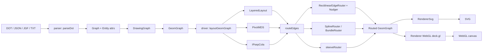
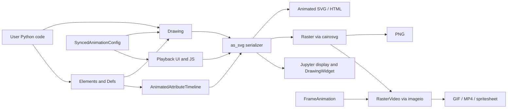
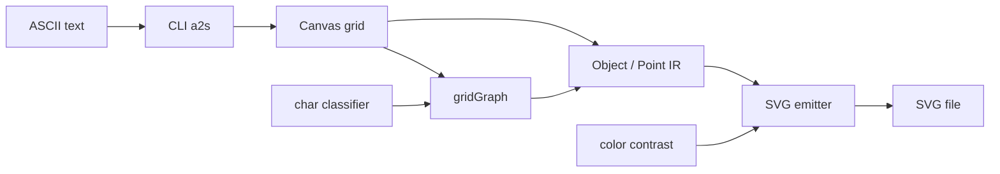
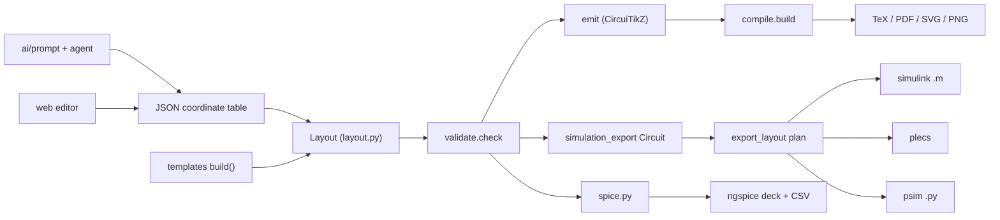

# Weekly scan — diagram tooling (2026-11-23)

| Field       | Value                                                                 |
|-------------|-----------------------------------------------------------------------|
| Window      | `pushed:>2026-11-16` (topic search) · `created:>2026-10-24` (keyword) |
| Sources     | `gh api search/repositories` + shallow clone (depth 30) & đọc code của từng repo |
| Status      | Automated scout — chưa review bởi người                               |

## Executive summary

- **microsoft/msagljs** (TS, ★176) là repo đáng đọc nhất lần này, dù tuần qua chỉ có một commit (ESM fix #163): rectilinear router của nó tách rõ *path search* (A\* với bend penalty = % Manhattan distance, scale-invariant) khỏi *nudging* (ordering tổ hợp các path chung segment → solver khoảng cách 1D theo free space → `StaircaseRemover`). Đây là phiên bản tổng quát của fan-in / trunk-lane staggering trong `alignment.py` — **study deeper** riêng `routing/rectilinear/nudging/`.
- **cduck/drawsvg** (Python, release 2.5.0/2.5.1 ngày 17–18/11) có hai ý dùng được ngay cho animated-SVG emitter của kymo: mọi `<animate>` chung một `dur` + `keyTimes` chuẩn hoá (đồng bộ không cần chuỗi `begin`), và `freeze_frame_at` — cùng dữ liệu timeline nội suy ra frame tĩnh, đúng nhu cầu của đường WebP qua resvg (không chạy SMIL).
- **asciitosvg** (Go, sống lại sau 6 năm bằng một PR viết lại scanner thành planar-graph face extraction) và **circuit-drawer-for-ee** (Python, v2.2.0, JSON coordinate table + validator ~65 mã lỗi) chỉ đáng **glance**: không cái nào có layout engine; giá trị nằm ở kỹ thuật bo góc kẹp bán kính và ở pattern "schema khai báo một lần → validator + LLM prompt".

**Cách chọn.** Topic search trả 75 repo (diagram-as-code 3, dsl 54, svg-animation 5, graph-visualization 12, layout-algorithm 1), phần lớn ngoài domain. Các scan trước đã cover lặp lại `reladraw`, `pintora`, `archify`, `goadesign/model`, `c4hero`, `archlang`, `kgdiff`, `homelab-diagram`, `birdview`… nên lần này ưu tiên repo **chưa từng deep-dive**. Loại: `plantuml`, `mermaid`, `d2` (không có thay đổi notable trong window), `eclipse-sprotty/sprotty` (tuần này chỉ dependabot), `alexeyw/lot-map` (71 commit nhưng là agent activity map, không diagram-specific), các repo "Microsoft Visio desktop" / "LanFlow" (spam), `stack-diagram` / `arch-diagram-skill` (agent prompt, không phải engine).

**Lưu ý độ tin cậy.** Số star lấy từ search API; contributors là cận dưới của clone depth-30; không repo nào được build hay chạy test — mọi nhận định đến từ đọc code.

## Table of contents

1. [microsoft/msagljs](#1-microsoftmsagljs) — study deeper (phần rectilinear nudging)
2. [cduck/drawsvg](#2-cduckdrawsvg) — glance only (`synced_animation.py`)
3. [asciitosvg/asciitosvg](#3-asciitosvgasciitosvg) — glance only
4. [ahainur/circuit-drawer-for-ee](#4-ahainurcircuit-drawer-for-ee) — glance only (`validate.py`, `schema.py`)

---

## 1. microsoft/msagljs

### §1 — Quick context

Port TypeScript của MSAGL: khác elkjs/dagre ở rectilinear router có nudging, edge bundling và sleeve routing cho graph lớn. Stack: TypeScript 4.6, lerna + yarn workspaces, esbuild, jest; deps `dotparser`, `deck.gl`, `panzoom`; output SVG, WebGL (skill script thêm PDF/PNG/EPS). Health: ★176; ≥4 contributors người (depth-30, cận dưới); tag: không xác định; `@msagl/core` 1.1.24; CI `test.yml` Node 20/22, 88 spec. Phân phối: npm `@msagl/*`, MIT.

### §2 — Architecture deep-dive

**A. Component inventory**
- `parseDot`/`parseJSON`/`parseJGF`/`parseTXT` (`modules/parser/src/dotparser.ts`) — input → `Graph`.
- `Graph`/`Entity` (`modules/core/src/structs/`) — topology + attribute slots.
- `DrawingGraph` (`modules/drawing/src/drawingGraph.ts`) — style, tạo geometry.
- `layoutGeomGraph` (`modules/core/src/layout/driver.ts`) — dispatcher layout + routing.
- `LayeredLayout` (`layout/layered/layeredLayout.ts`), `PivotMDS` (`layout/mds/pivotMDS.ts`), `IPsepCola` (`layout/incremental/iPsepCola.ts`).
- `RectilinearEdgeRouter` (`routing/rectilinear/RectilinearEdgeRouter.ts`), `SplineRouter` (`routing/splineRouter.ts`), `BundleRouter` (`routing/spline/bundling/BundleRouter.ts`), `sleeveRouter.ts`.
- `RendererSvg` (`modules/renderer-svg/src/rendererSvg.ts`), `Renderer` (`modules/renderer-webgl/src/renderer.ts`).

**B. Pipeline**
1. `parseDot(str)` → `Graph` kèm `DrawingGraph`.
2. `drawing.createGeometry()` đo text, gắn `GeomGraph`.
3. `layoutGeomGraph`: đệ quy subgraph, tách connected components, chọn engine (`figureOutSettings`: directed → Sugiyama; >2000 nodes → IPsepCola), rồi packing.
4. `routeEdges` theo `EdgeRoutingMode` (Rectilinear, Spline, SplineBundling, StraightLine, Sleeve).
5. Renderer vẽ; layout có thể chạy trong Web Worker (`renderer-common/src/layout.ts`).

**C. Data model / IR** — Mutable. `Entity` giữ mảng `attrs` theo index của `AttributeRegistry` (Geom=0, Drawing=1, AlgorithmData=2, Viewer=3): topology tách khỏi geometry và style, truy cập qua `GeomGraph.getGeom(graph)`.

**D. Input language** — Không tự viết grammar: dùng package `dotparser` (PEG) lấy AST rồi `DotParser` map attribute. Lỗi cú pháp chỉ `console.log` rồi `return null`; nhiều attribute `throw new Error('not implemented')`.

**E. Layout**
- *Sugiyama*: `CycleRemoval.getFeedbackSet` (DFS, back edges) → layering `NetworkSimplexForGeneralGraph` → `Ordering` (`layered/ordering/ordering.ts`): khởi tạo bằng DFS, lặp `LayerByLayerSweep` (weighted median `WMedian`, đổi chiều lên/xuống) + `AdjacentExchange` (swap cặp kề khi có gain, tối đa 50 lượt); đếm crossings bằng accumulator tree của Barth–Mutzel; `Restore()` nếu tệ hơn, hoà thì tung đồng xu; thử thêm trên graph đảo ngược (`tryReverse`). X-coordinate: `XCoordsWithAlignment` (Brandes) khi vượt `BrandesThreshold`, ngược lại `NetworkSimplex`.
- *Rectilinear router*: (1) `Obstacle` (`obstacle.ts`) bọc mỗi shape bằng `PaddedPolyline`; obstacle chồng nhau gộp `OverlapConvexHull`. (2) `SparseVisibilityGraphGenerator` (mặc định trong constructor; theo Clarkson et al.) chạy scanline hai hướng, sinh `ScanSegment` + Steiner points ở bounding box, giao nhau thành `VisibilityVertex`. (3) `PortManager` splice port vào graph tạm theo từng edge rồi gỡ ra. (4) `MsmtRectilinearPath` → `SsstRectilinearPath`: A* với priority queue, cost = `LengthImportance*length + BendsImportance*bends`; `BendsImportance` = 4% Manhattan distance source–target (scale-invariant); heuristic = Manhattan + số bends ước lượng; cắt nhánh theo `upperBoundOnCost`. (5) `Nudger.NudgePaths` chạy North → East → North: `PathRefiner`/`PathMerger` chuẩn hoá, `CombinatorialNudger` xếp thứ tự các path chung `AxisEdge` (DAG), `FreeSpaceFinder` sweep tìm biên trái/phải, `LongestNudgedSegment` thành biến, `UniformOneDimensionalSolver` ép khoảng cách `edgeSeparatian` (mặc định 3), cuối cùng `StaircaseRemover`. (6) `FitArcsIntoCorners` bo góc.

**F. Rendering** — SVG (`svgCreator.ts`, pan/zoom, `LayoutEditor` undo/redo) và WebGL deck.gl với `TileMap` tile-pyramid. Animation của edge/node: không xác định. Pluggable qua interface `IViewer`.

**G. Extensibility** — `layoutGeomGraphDetailed` nhận `layoutEngine`, `edgeRouter`, `packing` dạng callback; `GraphStyleSpecification` JSON schema cho WebGL. Plugin registry: không có.

**H. Dev experience** — Docs Docusaurus (`website/docs`), 11 examples, Agent Skill (`skills/msagljs`). #163 thêm bước `build-esm` (esbuild bundle ESM, `@msagl/*` external) cho core/drawing/parser cùng `node-esm.spec.ts`: sửa việc import trực tiếp trong Node ESM.

### §3 — Architecture diagram



### §4 — Verdict

**Áp dụng cho kymostudio**: (1) tách nudging thành *ordering tổ hợp* (`CombinatorialNudger`) rồi *giải khoảng cách 1D* theo free space — thay thế tổng quát cho trunk-lane staggering; (2) bend penalty tính theo % Manhattan distance, không hằng số pixel; (3) `StaircaseRemover` làm post-pass; (4) lượt `tryReverse` + adjacent-swap cho BPMN auto-layout.

**Red flags**: port máy móc từ C# — tên PascalCase, typo (`edgeSeparatian`, `SparseVisibiltyGraphGenerator`), 303 dòng comment trong `Nudger.ts` phần lớn là debug code chết; parser nuốt lỗi; ordering dùng random (seed mặc định 1 qua `initRandom`); core có 4 runtime deps; 24/30 commit gần nhất là dependabot.

**Open questions**: nudger có deterministic đủ cho golden byte-for-byte? Chi phí sparse visibility graph với diagram <100 nodes?

**Verdict**: **study deeper** — riêng `routing/rectilinear/nudging/`; phần còn lại glance only.

---

## 2. cduck/drawsvg

### §1 — Quick context

Thư viện Python dựng SVG bằng code, khác biệt ở keyframe API sinh SMIL đồng bộ kèm thanh scrub nhúng ngay trong file SVG.

- **Stack**: Python thuần, `install_requires` rỗng; extras `raster` (cairoSVG, numpy, imageio, imageio_ffmpeg), `color` (pwkit). Output: SVG, HTML, PNG, GIF, MP4, spritesheet, Jupyter.
- **Health**: ★698; ≥10 tên tác giả trong 30 commit (cận dưới, clone depth 30); tag mới nhất 2.5.1 (2026-11-18). Không có `.github/workflows`; đúng 1 file test.
- **Distribution**: PyPI `drawsvg` (`setup.py`, không có `pyproject.toml`).

### §2 — Architecture deep-dive

**A. Component inventory**

- `Drawing` (`drawsvg/drawing.py`) — canvas gốc, serializer `as_svg`/`as_html`, các entry `save_*`/`as_*`.
- `Context`, `LocalContext`, `DrawingBasicElement`, `DrawingParentElement` (`drawsvg/types.py`) — base class element, ghi tag, hook `invert_y` và animation.
- Elements (`drawsvg/elements.py`) — `Rectangle`, `Circle`, `Path`, `Text`, `Animate`, `AnimateMotion`, `AnimateTransform`, `AnimatableLine`…
- Defs (`drawsvg/defs.py`) — gradient, `ClipPath`, `Mask`, `Filter`, `Marker`.
- `SyncedAnimationConfig`, `AnimatedAttributeTimeline`, `AnimationHelperData` (`drawsvg/native_animation/synced_animation.py`) — timeline keyframe → SMIL.
- Playback UI (`drawsvg/native_animation/playback_control_ui.py`, `playback_control_js.py`) — vẽ thanh scrub và JS điều khiển.
- `Raster` (`drawsvg/raster.py`) — SVG → PNG qua cairosvg.
- `RasterVideo`, `render_svg_frames` (`drawsvg/video.py`) — ghép frame thành GIF/MP4/spritesheet qua imageio.
- `FrameAnimation` (`drawsvg/frame_animation.py`) — animation frame-by-frame, mỗi frame một `Drawing`.
- `DrawingWidget`, `AsyncAnimation` (`drawsvg/widgets/`) — ipywidget có callback chuột.

**B. Pipeline**

1. User tạo `Drawing(w, h, animation_config=SyncedAnimationConfig(duration=8))`, rồi `append()` element.
2. `elem.add_key_frame(t, cx=…)` ghi `(time, value)` vào một `AnimatedAttributeTimeline` cho mỗi attribute; time lùi sẽ raise `ValueError`.
3. `as_svg()` ghi `<defs>`, chạy một lượt `dry_run` để cấp id cho element được tham chiếu, rồi ghi element thật.
4. Khi ghi, `all_children()` gọi `as_animate_element(config)`: mỗi timeline thành một `<animate attributeName dur values keyTimes repeatCount fill>`. `keyTimes = (start_delay + t) / total_duration`, làm tròn 3 chữ số, tự chèn mốc 0 và 1. Mọi `<animate>` dùng chung `dur` nên đồng bộ mà không cần `begin`.
5. `Context.extra_prepost_drawing_elements` nối thêm group `#scrub`; knob và progress bar cũng được animate bằng chính `add_key_frame`. JS chèn trong `<script>`, kích hoạt qua `onload="svgOnLoad(event)"`, gọi `pauseAnimations()`/`setCurrentTime()` và đọc tham số từ `data-*`.
6. Video: `as_animation_frames(fps)` đặt `freeze_frame_at=t` cho từng frame; `override_args` nội suy tuyến tính attribute, bỏ `<animate>`; mỗi frame qua cairosvg rồi imageio.

**C. Data model / IR** — Cây object mutable: `args` dict (attribute SVG đã normalize), `children`, `ordered_children` theo z. `Context` và `LocalContext` là frozen dataclass. Không có IR thấp hơn; element tự ghi chuỗi XML.

**D. Input language** — Không có text DSL hay parser; "DSL" là Python API. `Path` có method chain `.M().L().C()`.

**E. Layout** — Không có layout engine, routing hay auto-sizing; mọi toạ độ do user cấp. Chỉ có `origin`, `invert_y`, `set_pixel_scale`.

**F. Rendering** — Backend SVG duy nhất; raster luôn đi qua chuỗi SVG. Animation: SMIL native, hoặc frame-based. Rasterizer không pluggable (cairosvg hard-code, import lười).

**G. Extensibility** — Subclass `DrawingBasicElement` và đặt `TAG_NAME`; protocol `to_drawables()` cho `Drawing.draw()`; override `controls_draw_function` / `controls_js`. Không có plugin registry.

**H. Dev experience** — README 504 dòng, quick reference `docs/index.md` (mkdocs). Không có CI; test chỉ phủ `invert_y` cho path. Type hint lác đác.

**Tuần này**: `Line` kế thừa `Lines` → `Path`, endpoint nằm trong chuỗi `d` nên keyframe `x1/y1` vô hiệu. `AnimatableLine` (10 dòng) phát `<line x1 y1 x2 y2>`, cho phép animate endpoint. `Drawing(unit='mm')` thêm đơn vị vào `width`/`height`. Parse số trong path đổi sang thử `int` rồi `float`, bắt thêm `OverflowError`.

### §3 — Architecture diagram



### §4 — Verdict

**Áp dụng được cho kymostudio**
- Một timeline cho mỗi attribute, chung `dur` và `keyTimes` chuẩn hoá: đồng bộ mà không cần chuỗi `begin`.
- `freeze_frame_at`: cùng dữ liệu timeline dựng frame tĩnh bằng nội suy; hợp với đường WebP qua resvg, vốn không chạy SMIL.
- Thanh scrub tự chứa, chính nó là SMIL, điều khiển bằng `setCurrentTime`.

**Red flags**
- Frame export chỉ nội suy tuyến tính, không đọc `calcMode`/`keySplines` trong `animation_args`.
- Id `scrub*` hard-code; JS chỉ nghe mouse event, không có touch.
- cairosvg là rasterizer duy nhất; README ghi cairo không render pattern.
- Không có CI.

**Open questions**
- Nội dung issue #122: không xác định.
- Hành vi scrub trên Safari: không xác định.

**Verdict**: glance only — đọc riêng `synced_animation.py` (352 dòng).

---

## 3. asciitosvg/asciitosvg

### §1 — Quick context

Biến ASCII art vẽ tay thành SVG; tuần này thay scanner đệ quy bằng planar graph face extraction. Stack: Go 1.21, zero dependency (`go.mod` không có `require`), output chỉ SVG. Health: ★226; ≥3 contributors (lower bound của clone depth-30: 53 commits); không có git tag/release; không có CI (`.github/` không tồn tại); ~1.750 dòng test. Phân phối: `go install .../cmd/a2s@latest`.

### §2 — Architecture deep-dive

**A. Component inventory**
- `CLI` (`cmd/a2s/a2s.go`) — đọc flag, gọi `NewCanvas` rồi `CanvasToSVG`.
- `Canvas` (`canvas.go`) — chuẩn hoá input (UTF-8, CRLF, tab) thành grid, điều phối `findObjects`, quét text và tag.
- `gridGraph` (`graph.go`) — dựng connectivity graph, tách closed face và open path.
- `char` (`char.go`) — phân loại ký tự (line, corner, arrow, tick/dot).
- `Object` / `Point` (`object.go`, `point.go`) — IR: path/text kèm `RenderHint`.
- `SVG emitter` (`svg.go`) — sinh SVG bằng `fmt.Fprintf`.
- `color` (`color.go`) — tính màu chữ tương phản.

**B. Pipeline**
1. `a2s -i in.txt -o out.svg` đọc file hoặc stdin.
2. `NewCanvas` validate UTF-8, expand tab theo rune index, pad thành grid `[]char` kích thước W×H.
3. `newGridGraph`: mỗi cell là một vertex; các predicate `canConnectHorizontal/Vertical/Diag` quyết định edge theo 4 hướng tiến (E, S, SE, NE). Adjacency của mỗi vertex được sort theo 8 hướng la bàn. Các "seam" kiểu `++` được hoãn sang `resolveSeams`: chỉ nối khi hai đầu không thuộc hai face riêng biệt.
4. `extractObjects`: `markBridges` (Tarjan iterative) loại cut-edge; `walkBoundedFaces` duyệt half-edge (mỗi edge có cờ `usedFwd`/`usedRev`), tại mỗi vertex chọn entry kế tiếp trong vòng xoay sau edge vừa đến; chỉ giữ cycle có `signedArea2 > 0` (bỏ outer face); `filterBridgeFaces` loại face giả giữa hai đường song song. Edge còn lại đi qua `extractOpenPaths`: ưu tiên đi thẳng qua junction, dừng tại arrow, thành box hoặc ngã rẽ nhiều nhánh.
5. Cell chưa `visited` được `scanText` gom thành text; tag `[name]` và định nghĩa `[name]: {json}` nạp vào `options`.
6. `CanvasToSVG` emit ba group `closed` / `lines` / `text`, ghi ra file hoặc stdout.

**C. Data model / IR**
Một IR duy nhất: `canvas{grid, visited, objects, options}` và `object{points, corners, isClosed, isDashed, isText, isTagDef, tag}`. Mutable: `sealWith` ghi `Hint` vào từng `Point`, `SetTag` sửa sau khi tạo. `gridGraph` là IR trung gian, bỏ sau khi extract. Không có lower IR.

**D. Input language**
Không có grammar hình thức; "parser" là nhận dạng 2D bằng heuristic lân cận cục bộ (ví dụ chặn `C#-code` thành path). Tag definition là JSON một dòng qua `encoding/json`. Error reporting tối thiểu: lỗi UTF-8 kèm số dòng, lỗi JSON kèm tên tag; hình vẽ sai thì âm thầm thành text. `pointsToCornersWithClosed` vẫn `panic` khi points không liền kề.

**E. Layout**
Hoàn toàn user-specified: toạ độ là vị trí ký tự nhân `scaleX`/`scaleY` (mặc định 9×16). Không có auto-layout, edge routing hay crossing minimization; giao cắt chỉ được diễn giải (đi thẳng qua `+`).

**F. Rendering**
Một backend SVG 1.1 với template string. `flatten` gộp vertex thẳng hàng, bo góc bằng quadratic Bézier với bán kính kẹp ở nửa độ dài segment kề; drop-shadow qua filter `dsFilter`; marker `Pointer`/`iPointer`. Không animation, không pluggable.

**G. Extensibility**
Chỉ có styling theo tag: mọi SVG attribute cộng `a2s:delref`, `a2s:label`, `a2s:link`. README ghi custom objects (`a2s:type`) chưa implement. Plugin, theme: không xác định (không thấy trong code).

**H. Dev experience**
CLI 8 flag; gallery on-demand `go test -run TestRenderGallery -render-gallery` (39 case inline trong `gallery_test.go`). IDE, watch, browser preview: không có.

### §3 — Architecture diagram



### §4 — Verdict

**Áp dụng được:** (1) bo góc edge orthogonal bằng quadratic Bézier có bán kính kẹp `min(r, len/2)` trong `flatten` — hợp với trunk-lane stagger khi segment ngắn; (2) Tarjan bridge + half-edge face walk nếu kymostudio muốn một front-end import ASCII; (3) gallery sinh on-demand, không commit ảnh; (4) tự chọn màu chữ theo fill (`textColor`).

**Red flags:** `NewCanvas` nhận `noBlur` rồi bỏ (`_ = noBlur`); `panic` còn sót; `filterBridgeFaces` và `canConnect*` là chuỗi special-case khó bảo trì; XML ghép tay (TODO trong `svg.go`); không CI, không tag; im lặng 2020→2026 rồi năm commit trong một ngày.

**Open questions:** độ phức tạp thực tế có đúng O(W×H) như commit message khẳng định không; `resolveSeams` chạy face walk hai lần.

**Verdict:** glance only — khác bài toán (không layout), chỉ nên đọc `flatten` và `walkBoundedFaces`.

---

## 4. ahainur/circuit-drawer-for-ee

### §1 — Quick context

Bảng tọa độ JSON đặt tay (hoặc do LLM viết) cho mạch điện tử công suất, qua validator cứng rồi mới xuất CircuiTikZ và mô hình mô phỏng. Stack: Python >=3.10, core không dependency (optional `anthropic`, `mcp`); web editor JS thuần chạy trên `http.server`. Output: TeX/PDF/SVG/PNG (pdflatex + `pdftocairo`), ngspice, Simulink `.m`, `.plecs`, PSIM. ★69; 2 tên author trong `git log` (14 commit); tag mới nhất v2.2.0 (2026-11-20); không có CI, không có tests. Phân phối: wheel + installer Windows qua GitHub Releases; PyPI: không xác định.

### §2 — Architecture deep-dive

**A. Component inventory**
- `cli` (`src/circuit_drawer/cli.py`) — argparse, ~20 subcommand (`draw`, `render`, `check`, `edit`, `spice`, `plecs`, `simulink`, `new`, `tweak`…).
- `Layout` (`layout.py`) — dataclass "coordinate table", `PIN_NAMES` cho từng `kind`.
- `schema` (`schema.py`) — khai báo `Field` một lần, dùng chung cho validator và AI prompt.
- `templates` (`templates/*.py`, `templates/saved_tables/*.json`) — hàm `build(o)` viết tọa độ bằng tay.
- `geometry` (`geometry.py`) — `Footprint`/`Box`, ước lượng kích thước text, SAT overlap.
- `validate` (`validate.py`) — ~65 mã lỗi, `fit_scale`.
- `emit` (`emit.py`) — Layout → CircuiTikZ; `compile.py` chạy pdflatex/pdftocairo.
- `simulation_export` (`simulation_export.py`) — IR `Circuit`; `export_layout.py` — đặt part cho target.
- Exporters: `spice.py`, `simulink.py`, `plecs.py`, `psim.py`.
- `control/` (`model.py`, `check.py`, `arrange.py`, `emit.py`) — sơ đồ khối điều khiển.
- `editor/server.py` + `editor/static/index.html` (5.6k dòng) — web editor; `ai/prompt.py`, `agent.py`, `mcp_server.py` — lớp LLM.

**B. Pipeline** (docstring `pipeline.py`: "Options -> coordinate table -> validation -> CircuitikZ -> files")
1. `circuit-drawer render x.json` hoặc `draw <template>`.
2. `Layout.from_dict` / `templates.get(name).build(options)`.
3. `validate.check(layout, profile)` tính `Scale` và `Report`; có error thì raise `LayoutRejected`, không vẽ gì.
4. `emit()` ghi tọa độ nguyên văn thành TeX.
5. `compile.build()` → PDF → SVG/PNG.
6. Nhánh mô phỏng: `build_circuit()` → `emit(circuit, name)` của từng target + `manifest.json`.

**C. Data model / IR.** Hai tầng: `Layout` (elements có `pins` tọa độ tuyệt đối, `wires` polyline, `hops`, `annotations`, `netlist`, `modes`, phần trang trí trong `extra`) và `Circuit` (`Part`, `Signal`, `Subsystem`, `pin_nodes`, `transient`, `drawing`) cho mô phỏng.

**D. Input language.** Không có DSL hay grammar; chỉ JSON, parse bằng `from_dict`. Snippet thật (`examples/spice/boost.json`, rút gọn whitespace):
```json
{"id": "L1", "kind": "L", "pins": {"a": [0.6, 3.0], "b": [1.9, 3.0]}, "label": "$L_1$"}
"wires": [[[0.0, 3.0], [0.6, 3.0]], ...],
"netlist": {"Vin.b": "IN", "L1.a": "IN", "L1.b": "SW", ...}
```
Error reporting là điểm mạnh nhất: `Issue(code, message, level)` nêu id và tọa độ; `netlist` khai báo được đối chiếu với nối dây đã vẽ (`netlist-open`, `netlist-short`).

**E. Layout.** Mạch điện: hoàn toàn user-specified — `layout.py` ghi "Nothing in this package places parts automatically". Dây vẽ tay, validator ép orthogonal (`not-orthogonal`), giao cắt phải khai `hops` (`unmarked-crossing`); không có crossing minimization. `fit_scale` chỉ giãn khoảng cách, kích thước symbol giữ tuyệt đối theo cm. Riêng control diagram có auto-placement: `control/arrange.py` xếp cột theo rank trên DAG (cắt back-edge bằng DFS), đường hồi tiếp đi lane; link vẫn là `via` point tường minh.

**F. Rendering.** Một backend vẽ: CircuiTikZ. Symbol không tự vẽ mà ánh xạ `CTIKZ_KIND` sang primitive CircuiTikZ; icon khối là polyline trong `glyphs.py`. SVG/PNG chỉ là chuyển đổi từ PDF. Không animation; "modes" là ảnh tĩnh tô đường dẫn dòng. Không pluggable.

**G. Extensibility.** Template Python, saved-template JSON, `module_library/*.json`, MCP server (`create_candidate`, `validate_candidate`, `render_candidate`…). Không có plugin API.

**H. Dev experience.** README + manual ba ngôn ngữ, CHANGELOG 646 dòng. Repo là snapshot phát hành (`SOURCE_COMMIT`, commit đầu 243 file/62k dòng); `.gitattributes` trỏ tới `docs/verification/` không tồn tại.

### §3 — Architecture diagram



### §4 — Verdict

Kỹ thuật đáng lấy: (1) `schema.Field` khai báo một lần, sinh cả validator lẫn tài liệu trong LLM prompt — hợp với việc giữ `DSL.md` và parser đồng bộ; (2) validator hình học có mã lỗi, kèm id và tọa độ, làm vòng phản hồi cho LLM tự sửa; (3) khai báo `netlist` dư thừa để đối chiếu với hình vẽ; (4) `export_layout` tái dùng hình đã vẽ khi fan-out sang tool khác thay vì layout lại. Red flags: không tests/CI trong repo công khai, lịch sử là các commit "Release" khổng lồ, `index.html` 5.6k dòng, thông báo lỗi trộn tiếng Trung và Anh. Về bản chất là GUI + agent quanh một JSON, không phải diagram-as-code có ngôn ngữ. Câu hỏi mở: repo nguồn thật có tests không; tỷ lệ code do AI sinh — không xác định. Verdict: glance only (đọc `validate.py`, `schema.py`).

